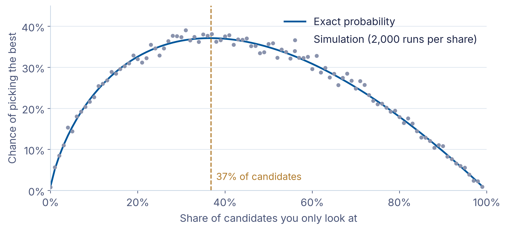

## Today in one sentence

<span class="statement">When options come one by one and you can't go back, look at the first 37% without committing, then take the first one that beats them all.</span>

<span class="eyebrow">Why it matters</span>

You visit flats in Hamburg. Each viewing, you must decide on the spot, and if you say no, the flat is gone. Choose too early and you miss better ones; wait too long and the best is behind you. Companies face the same problem when hiring, choosing suppliers or accepting offers.

## Roadmap

1.  <span class="roadmap-item future">The problem: choosing the best when options come one at a time</span>
2.  <span class="roadmap-item future">The rule: look first, then leap</span>
3.  <span class="roadmap-item future">Real life: when the assumptions change</span>

# <span class="flow">The problem: choosing the best when options come one at a time</span>

## Options come one by one, and there is no going back

<span class="question">Question:</span> Does anybody know what optimal stopping is?

- <span class="highlight">Optimal stopping</span> is the problem of choosing the **best option**
- from a **sequence of options**
- that are revealed **one by one**

## 

Does anybody have

an example of

optimal stopping?

## <span class="invert-font">Flat Hunting</span>

<span class="invert-font">Photo by <a href="https://unsplash.com/@jiren_091">Aditya Ghosh</a> on Unsplash</span>

## <span class="invert-font">Hiring applicants</span>

<span class="invert-font">Photo by <a href="https://unsplash.com/@homajob">Scott Graham</a> on Unsplash</span>

## <span class="invert-font">Dating</span>

<span class="invert-font">Photo by <a href="https://unsplash.com/@shelbymary_">Shelby Deeter</a> on Unsplash</span>

## The Secretary Problem: hire now or keep looking?

- You are **hiring a secretary** and interview candidates **one by one**
- After each interview: **hire or continue searching**
- Once you reject a candidate, **you cannot go back**
- How to <span class="highlight">maximize the chance of hiring the best candidate?</span>

## The setup in three lines

- We have `n` candidates and interview them **one by one**
- After each one: **hire or continue searching**
- We can only **rank** candidates relative to those we have already seen (<span class="highlight">ordinal ranking</span>)

<span class="question">Question:</span> Where in your life can you say "this one is better than that one", but not "this one is worth 7 out of 10"?

## Two ways to fail

<span class="question">Question:</span> Any idea how we could fail?

1.  Reject everyone and never hire: <span class="highlight">stopping too late</span>
2.  Hire someone too early: <span class="highlight">stopping too early</span>

## 

How would you

decide when to stop?

# <span class="flow">The rule: look first, then leap</span>

## Roadmap

1.  <span class="roadmap-item done">The problem: choosing the best when options come one at a time</span>
2.  <span class="roadmap-item current">The rule: look first, then leap</span>
3.  <span class="roadmap-item future">Real life: when the assumptions change</span>

## Look at the first 37%, then leap

1.  **Look** at the <span class="highlight">first 37%</span> of candidates without hiring anyone
2.  **Remember** the best candidate so far
3.  **Leap:** hire the next candidate who is **better than that one**
4.  This finds the very best candidate in **37%** of all cases

## Picking at random gets worse with every candidate

Chance of the best candidate if we **pick one at random**:

- 1 candidate: 100%, 2 candidates: 50%, 3 candidates: 33%
- 4 candidates: 25%, 5 candidates: 20%

<span class="question">Question:</span> Do you see the pattern?

**Pattern:** 1/n. Look-and-leap **never drops below 37%**, however many candidates there are.

## Why 37%?

- Look at the first share $x$ of candidates, then leap
- Chance of getting the best: about $-x \ln x$[^1]
- In words: look longer and your benchmark improves, but the best may already be gone
- Largest at $x = 1/e \approx 37\%$[^2]

## Let the computer try it out

1.  Shuffle 100 candidates into a random order
2.  Look at the first 37 and remember the best one
3.  Hire the first candidate who beats that benchmark
4.  Check: did we get the very best?
5.  Repeat 10,000 times and count how often we won

## The same idea in code

``` python
import random
random.seed(42)

def one_round(n=100, look=37):
    candidates = list(range(n))          # n - 1 is the best
    random.shuffle(candidates)
    benchmark = max(candidates[:look])   # best of the look phase
    for c in candidates[look:]:
        if c > benchmark:                # first one who beats it
            return c == n - 1            # did we hire the best?
    return False                         # nobody beat the benchmark

wins = sum(one_round() for _ in range(10_000))
print(f"Best candidate found in {wins / 10_000:.1%} of rounds")
```

    Best candidate found in 37.5% of rounds

> **Note**
>
> No worries if you don't understand every line yet. By the end of the course, you will.

## Simulation: looking at 37 of 100 candidates works best

100 candidates, 2,000 simulated runs per stopping point:



# <span class="flow">Real life: when the assumptions change</span>

## Roadmap

1.  <span class="roadmap-item done">The problem: choosing the best when options come one at a time</span>
2.  <span class="roadmap-item done">The rule: look first, then leap</span>
3.  <span class="roadmap-item current">Real life: when the assumptions change</span>

## Real life changes the assumptions

So far, we made some strong simplifications. Real life is messier.

<span class="question">Question:</span> What could be different in real life?

- The other person can **say no**
- You can **go back** to someone you passed
- You **know how good** an option is, not just how it compares
- You have **a fixed time**, not a fixed number of options
- One failure can mean **losing everything**
- Looking **costs time and effort**

## What if you can be rejected?

<span class="question">Question:</span> In dating, <span class="highlight">the other person can also say no</span>. **Earlier or later than 37%?**

- 50% chance of rejection: **leap at 25%**
- **Formula:** $q^{\frac{1}{1-q}}$, $q$ = chance that your offer is **accepted**[^3]
- In words: the more often you hear "no", the earlier you leap

## What if you can go back?

<span class="question">Question:</span> You can **return to someone you passed on**, but they might say no. **Look longer or shorter?**

- Going back works only half the time: **look at 61%**[^4], then leap
- If nobody better comes, **return to the best** you passed
- In words: a second chance makes it safe to look longer

## What if you know how good an option is?

<span class="question">Question:</span> Test scores, prices per square meter: **do we still need a look phase?**

- Example: you know test scores, or the price per square meter of a flat
- **No look phase needed:** take the first option above a threshold
- The threshold **drops** as fewer options remain
- Chance of getting the very best rises to **58%**[^5]

## What if time is fixed?

**Example:** one year to find a flat, viewings come as they come

<span class="question">Question:</span> How should we adapt our strategy?

- **Same principle:** look for the first 37% of the time[^6], then leap
- The number of options is not fixed: **the harder we search, the more options we see**

## The burglar: when to retire?

**Example:** each break-in succeeds with chance $q$, one failure means losing everything

<span class="question">Question:</span> Does the answer depend on $q$, and how?

- Stop after about $\frac{q}{1-q}$ successes
- With $q = 90\%$: retire after **9** break-ins[^7]
- Same logic for any streak that can end badly: a winning run in the casino, a project that keeps growing in risk

## What do people actually do?

- In about a dozen experiments, people **leap earlier** than the 37% rule suggests[^8]
- <span class="question">Question:</span> Why might that be?
- Searching costs **time and effort**, and the rule ignores that
- If looking is expensive, leaping earlier can be **the right choice**

## What we covered

<span class="eyebrow">The problem: choosing the best when options come one at a time</span>

Many decisions share one structure: options arrive one at a time, and there is no going back.

<span class="eyebrow">The rule: look first, then leap</span>

Looking at the first 37% and then taking the first better option gives the best possible chance of picking the very best: 37%.

<span class="eyebrow">Real life: when the assumptions change</span>

The rule adapts to real life: leap earlier if you can be rejected or looking is costly, wait longer if you can go back.

## Why it matters

You visit flats in Hamburg. Each viewing, you must decide on the spot, and if you say no, the flat is gone. Choose too early and you miss better ones; wait too long and the best is behind you. Companies face the same problem when hiring, choosing suppliers or accepting offers.

## 

Look first.

Then leap.

## 

Any questions

so far?

## After the break: First Steps in Python

- A gentle introduction to Python in our notebooks
- We turn today's idea into **code and experiments**
- This is how **algorithmic thinking** starts: break a decision into logical steps

# <span class="flow">Literature</span>

## Interesting literature to start

- Christian, B., & Griffiths, T. (2016). Algorithms to live by: the computer science of human decisions. First international edition. New York, Henry Holt and Company.[^9]

## Optimal Stopping in Depth

- Ferguson, T.S. (1989). Who solved the secretary problem? Statistical Science, 4(3). doi:10.1214/ss/1177012493.

## Books on Programming

- Downey, A. B. (2024). Think Python: How to think like a computer scientist (Third edition). O'Reilly. [Free online](https://greenteapress.com/wp/think-python-3rd-edition/)
- Elter, S. (2021). Schrödinger programmiert Python: Das etwas andere Fachbuch (1. Auflage). Rheinwerk Verlag.

> **Note**
>
> Think Python is free online and a great start. Schrödinger programmiert Python is a playful alternative in German.

## More Literature

For more interesting literature, take a look at the [literature list](../general/literature.qmd) of this course.

[^1]: Where does this come from? You win if the best candidate comes after your look phase and nobody before them beats your benchmark. That happens exactly when the best of all earlier candidates was in your look phase. Adding up these chances for every position, with many candidates, gives about $-x \ln x$, where $x$ is the share of candidates you only look at.

[^2]: To find the best look phase, we only need to know where $-x \ln x$ reaches its maximum. Setting its derivative $-\ln x - 1$ to zero gives $x = 1/e \approx 37\%$, where $e \approx 2.718$ is the base of the natural logarithm. For the full story, see Ferguson, T.S. (1989) 'Who solved the secretary problem?', Statistical Science, 4(3).

[^3]: How it works: after the look phase, you ask everyone who beats all earlier candidates, and each says yes with chance $q$. You get the best only if the best says yes and everyone you asked before said no. More rejections mean you use up more candidates after the look phase, so you have to start earlier. The stated formula is the best look phase, for example 25% when $q = 50\%$. As in the basic problem, your chance of getting the best equals the look phase. With $q$ close to 1, it gives back 37%.

[^4]: Christian, B. & Griffiths, T. (2016). Algorithms to Live By. Henry Holt, Chapter 1.

[^5]: Gilbert, J.P. & Mosteller, F. (1966). Recognizing the maximum of a sequence. Journal of the American Statistical Association, 61(313), 35--73.

[^6]: Christian, B. & Griffiths, T. (2016). Algorithms to Live By. Henry Holt, Chapter 1.

[^7]: Ferguson, T.S. Optimal Stopping and Applications. Lecture notes, University of California, Los Angeles, https://www.math.ucla.edu/~tom/Stopping/. The rule assumes the same haul every time: stop once your total haul is worth more than what you would expect to gain from one more attempt.

[^8]: Christian, B. & Griffiths, T. (2016). Algorithms to Live By. Henry Holt, Chapter 1.

[^9]: The main inspiration for this lecture. We have read it and discussed it in depth, always wanting to translate it into a course.
