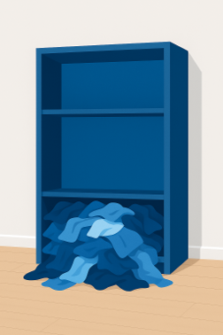
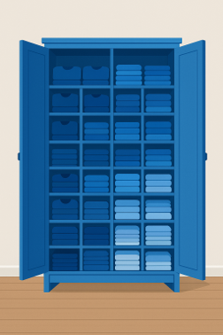
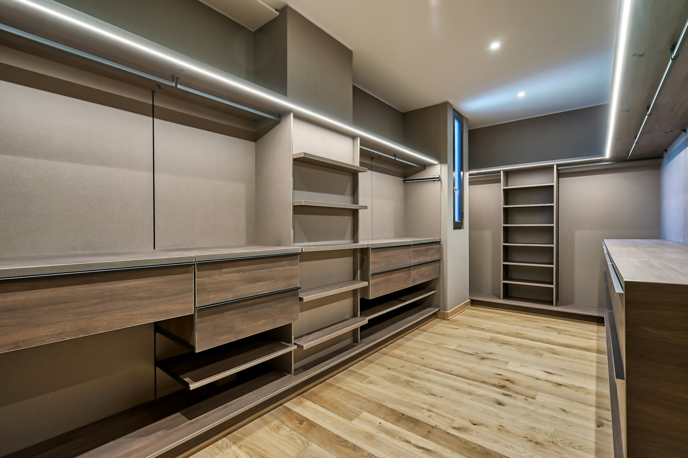
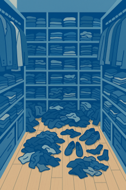
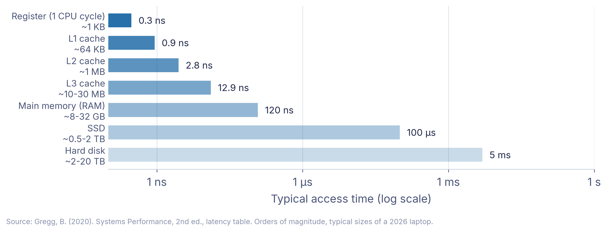

## Today in one sentence

When space is limited, keep close what you are likely to need next, and the best guide to that is what you used most recently.

Why it matters

Your cupboard is full, your desk is cluttered, your inbox overflows. Companies have the same problem: which goods sit next to the loading dock, which files stay on the fast server, which tasks get your attention today.

## Roadmap

1.  The problem: limited space, too much stuff
2.  The solution: keep what you need close, clear out the rest
3.  Your mind is a cache: protecting your attention

# The problem: limited space, too much stuff

## A quick question first

Question: **How many of you have a messy desktop right now?** Raise your hand!

Today's lecture will explain why that matters more than you think...

## An everyday problem: the cupboard is full

<table>
<colgroup>
<col style="width: 50%" />
<col style="width: 50%" />
</colgroup>
<tbody>
<tr>
<td style="text-align: left;">

<ul>
<li>We have a problem: Our cupboard.</li>
<li>It’s time to put things in order.</li>
</ul>

</td>
<td style="text-align: left;">

</td>
</tr>
</tbody>
</table>

## Organize better, or clear out?

Question: What could we do?

<table>
<colgroup>
<col style="width: 50%" />
<col style="width: 50%" />
</colgroup>
<tbody>
<tr>
<td style="text-align: left;">

<ul>
<li>Better organization</li>
<li>Clearing out things we no longer need</li>
<li>Now we have two problems:
<ul>
<li>Storing?</li>
<li>Clearing out?</li>
</ul></li>
</ul>

</td>
<td style="text-align: left;">

</td>
</tr>
</tbody>
</table>

## Two ways out: better organization or more space

<table>
<colgroup>
<col style="width: 50%" />
<col style="width: 50%" />
</colgroup>
<tbody>
<tr>
<td style="text-align: left;">

<ul>
<li><strong>Better Organization:</strong>
<ul>
<li>Subdivide storage</li>
<li>Efficient sorting</li>
</ul></li>
<li><strong>More Space:</strong>
<ul>
<li>Increase capacity</li>
</ul></li>
<li>Question: Which approach is better?</li>
</ul>

</td>
<td style="text-align: left;">

</td>
</tr>
</tbody>
</table>

## Even the best organization has limits

<table>
<colgroup>
<col style="width: 50%" />
<col style="width: 50%" />
</colgroup>
<tbody>
<tr>
<td style="text-align: left;">

<ul>
<li>Organization helps, but takes time.</li>
<li>More space helps, but has limits.</li>
<li><strong>Every storage has a finite capacity.</strong></li>
</ul>

</td>
<td style="text-align: left;">

</td>
</tr>
</tbody>
</table>

## When storage is full, we could buy more

Question: What do we do when the storage is full?

**We could increase the capacity**

## But more space is costly and slow

<table>
<colgroup>
<col style="width: 50%" />
<col style="width: 50%" />
</colgroup>
<tbody>
<tr>
<td style="text-align: left;">

<ul>
<li>Increasing capacity costs money</li>
<li><strong>Trade-off:</strong> size vs. speed, larger is slower to search</li>
<li>Sooner or later it still fills up</li>
</ul>

</td>
<td style="text-align: left;">

</td>
</tr>
</tbody>
</table>

## Every storage has this problem

Question: What else faces this problem?

- Cupboards
- Computers
- Email inbox
- Smartphones
- Warehouses
- **Our brain?!**

## Full storage slows everything down

Question: What is the impact of full storage?

<table>
<colgroup>
<col style="width: 50%" />
<col style="width: 50%" />
</colgroup>
<tbody>
<tr>
<td style="text-align: left;">

<ul>
<li>Access speed drops</li>
<li>Processing time up</li>
<li>Performance down</li>
</ul>

</td>
<td style="text-align: left;">

</td>
</tr>
</tbody>
</table>

## So we have to clear out, but what goes?

- True for cupboards, computers, brains...
- **But what stays and what goes?**

## Computers hit the same wall

- 1946: von Neumann's team expects a **hierarchy of memories**[^1]
- Processors got faster much quicker than memory (Moore's Law, 1965)
- 1965: Maurice Wilkes proposes a small, fast memory, the first **cache**
- 1995: Wulf and McKee call the growing gap the **Memory Wall**

## A fast processor waiting for slow memory

- **Modern CPUs:** billions of operations per second
- **Problem:** data doesn't arrive fast enough
- Question: What's the point of a fast CPU that waits for slow memory?

**→ The Von Neumann bottleneck**[^2]

## The problem: limited space, too much stuff

What we covered

Every storage system faces the same question: what to keep close and what to clear out.

# The solution: keep what you need close, clear out the rest

## Roadmap

1.  The problem: limited space, too much stuff
2.  The solution: keep what you need close, clear out the rest
3.  Your mind is a cache: protecting your attention

## The cache: a hierarchy of memories

**A hierarchical memory system**

- **L1 Cache:** Tiny but ultra-fast (kilobytes)
- **L2/L3 Cache:** Larger, still fast (megabytes)
- **RAM:** Main workspace (gigabytes)
- **Storage:** Huge but slow (terabytes)

**Like a library...**

## Like a library: closer is faster and smaller

<table>
<colgroup>
<col style="width: 50%" />
<col style="width: 50%" />
</colgroup>
<tbody>
<tr>
<td style="text-align: left;">

<ul>
<li><strong>Library storage</strong> (millions of books, mass storage)</li>
<li><strong>Subject shelves</strong> (thousands of books, RAM)</li>
<li><strong>Your desk</strong> (a few borrowed books, L2)</li>
<li><strong>Short-term memory</strong> (current page, L1)</li>
</ul>

<strong>Closer = Faster = Smaller</strong>

</td>
<td style="text-align: center;">

</td>
</tr>
</tbody>
</table>

## Fast memory is small, big memory is slow

A register is roughly **ten million times faster** than a hard disk. Question: **Why not make everything that fast?**

## Why not make everything fast?

- **Physics:** larger memory sits further away, signals take longer, fast memory gets hot
- **Money:** per gigabyte, cache memory costs many times more than a hard disk
- **Solution:** several levels, each optimized for its job

## Small and fast means clearing out regularly

<table>
<colgroup>
<col style="width: 50%" />
<col style="width: 50%" />
</colgroup>
<tbody>
<tr>
<td style="text-align: left;">

<ul>
<li>L1 and L2 cache only contain most necessary data.</li>
<li>The same should apply to your desk.</li>
<li>Therefore, both must be cleared regularly.</li>
</ul>

</td>
<td style="text-align: left;">

</td>
</tr>
</tbody>
</table>

## Four ways to decide what goes

Question: Which eviction strategies can you think of?

- Random
- First-In, First-Out (FIFO)
- Least Frequently Used (LFU)
- Least Recently Used (LRU)

## The perfect strategy needs a crystal ball

- **Optimal: Clairvoyance**
  - Keep what you'll need
  - Remove what you won't
- Question: What's the problem?

**→ Requires knowledge of the future!**

## In practice: throw out what you used longest ago

- **Least Recently Used (LRU)** is the dominant strategy
- When space is needed, evict the item that was **not used for the longest time**
- On average much better than, for example, random eviction
- Question: Why is this the better strategy?

## LRU works because the recent past predicts the near future

- **Temporal locality:** what you used recently, you will likely need again soon
- Books on your desk, apps opened today, people texted this morning
- In Belady's classic comparison, LRU came closest to the crystal ball[^3]

## Marie Kondo is LRU for your home

- **Let go of unused things** → LRU principle
- **Keep things where used** → Spatial locality
- **Result:** Significant productivity increase

**Marie Kondo = LRU for physical objects!**

## Spatial locality: keep things where you use them

Question: Can you think of examples where spatial locality is applied in your daily life?

**Mathematically optimal**

## The solution: keep what you need close, clear out the rest

What we covered

Fast storage is always small, so we need a rule for clearing out. Least Recently Used works because the recent past predicts the near future.

# Your mind is a cache: protecting your attention

## Roadmap

1.  The problem: limited space, too much stuff
2.  The solution: keep what you need close, clear out the rest
3.  Your mind is a cache: protecting your attention

## Our brains are caches

- **Why does this matter for humans?**
- Your brain works like a cache: **limited capacity** for active information
- **Fast access** to what you used recently
- It constantly decides **what to keep and what to forget**

## Caches can be flooded and poisoned

- **Cache flooding:** overload the cache, so important data gets evicted and everything slows down
- **Cache poisoning:** plant **false data**, so later requests get wrong answers
- Both exploit that a cache is **small** and **trusted** without checking

## Five productivity killers

- **Overload:** too much information at once
- **Exhaustion:** too long without clearing out
- **Context switching:** often 20+ minutes to get back on track[^4]
- **Distraction:** cache flooding by notifications and social media
- **Misinformation:** cache poisoning by fake news

## Your attention is under attack

- **Technology and social media** are designed to capture attention (cache flooding)
- **Constant interruptions:** every notification is a forced eviction
- **Result:** less creativity, critical thinking and productivity

Reflection: How many times did you check your phone during this lecture?

## Manage your mental cache

- Limit screen time and practice "monotasking"
- Prioritize sleep, nutrition and mindful habits
- Create protected time for deep work
- Be selective about what enters your attention

## Distraction can't be avoided, but it can be reduced

- Distraction is everywhere, especially for managers
- Awareness is the first step to keep your brain working well
- **Want to dive deeper? Read "Stolen Focus" by Johann Hari**

## Three levels of attention: spotlight, starlight, daylight

- **Spotlight:** what you work on right now (your L1 cache)
- **Starlight:** your goals for this week or month (your L2 cache)
- **Daylight:** your long-term values and direction (your storage)

## Five practical strategies

- **Prioritize:** what deserves a place in your mental cache?
- **Time-box:** structure prevents overflow
- **Take breaks:** regular clearing out prevents exhaustion
- **Enable flow:** dedicated workspace, fewer notifications
- **Meditation and exercise:** maintenance for your cache

## Your desk as a cache hierarchy

- **Hot cache (on your desk):** only today's tasks
- **Warm cache (nearby shelf or drawer):** this week's projects
- **Cold storage (archive or closet):** everything else

**Key principle:** if you haven't used it recently, move it away!

## Self-assessment

Question: **Right now:**

1.  How many browser tabs do you have open? \_\_\_
2.  How many notifications did you receive in the last hour? \_\_\_
3.  How many unread emails in your inbox? \_\_\_

**Do you see any risks of cache flooding?**

## Your mind is a cache: protecting your attention

What we covered

Your attention works like a cache: small, valuable and easily flooded, so protect it.

## What we covered

The problem: limited space, too much stuff

Every storage system faces the same question: what to keep close and what to clear out.

The solution: keep what you need close, clear out the rest

Fast storage is always small, so we need a rule for clearing out. Least Recently Used works because the recent past predicts the near future.

Your mind is a cache: protecting your attention

Your attention works like a cache: small, valuable and easily flooded, so protect it.

## Why it matters

Your cupboard is full, your desk is cluttered, your inbox overflows. Companies have the same problem: which goods sit next to the loading dock, which files stay on the fast server, which tasks get your attention today.

## 

What you used last, you'll need next.

# Literature

## Interesting literature to start

- Christian, B., & Griffiths, T. (2016). Algorithms to live by: the computer science of human decisions. First international edition. New York, Henry Holt and Company.[^5]

## Books on Programming

- Downey, A. B. (2024). Think Python: How to think like a computer scientist (Third edition). O'Reilly. [Free online](https://greenteapress.com/wp/think-python-3rd-edition/)
- Elter, S. (2021). Schrödinger programmiert Python: Das etwas andere Fachbuch (1. Auflage). Rheinwerk Verlag.

> **Note**
>
> Think Python is free online and a great start. Schrödinger programmiert Python is a playful alternative in German.

## More Literature

For more interesting literature, take a look at the [literature list](../general/literature.qmd) of this course.

[^1]: Burks, A. W., Goldstine, H. H., & von Neumann, J. (1946). Preliminary discussion of the logical design of an electronic computing instrument. Wilkes, M. V. (1965). Slave memories and dynamic storage allocation. Wulf, W. A., & McKee, S. A. (1995). Hitting the memory wall. See also Christian & Griffiths (2016), ch. 4.

[^2]: Term coined by John Backus (1977).

[^3]: Belady, L. A. (1966). A study of replacement algorithms for a virtual-storage computer. IBM Systems Journal, 5(2), 78--101; see also Christian & Griffiths (2016), ch. 4. In Tutorial III.III you measure LRU against random eviction yourself.

[^4]: Order of magnitude from Gloria Mark's workplace studies, e.g. Mark, G., Gonzalez, V. M., & Harris, J. (2005). No task left behind? Examining the nature of fragmented work. CHI 2005.

[^5]: The main inspiration for this lecture. We have read it and discussed it in depth, always wanting to translate it into a course.
