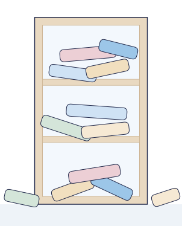
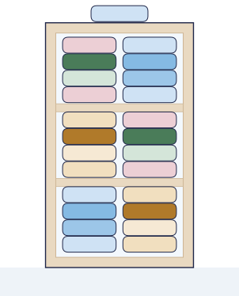
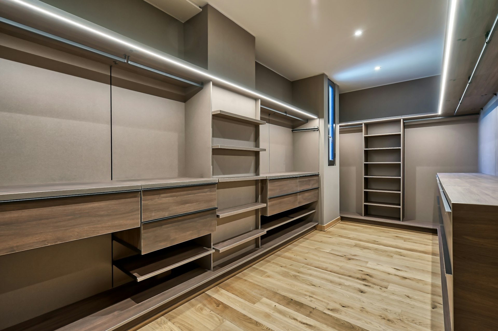
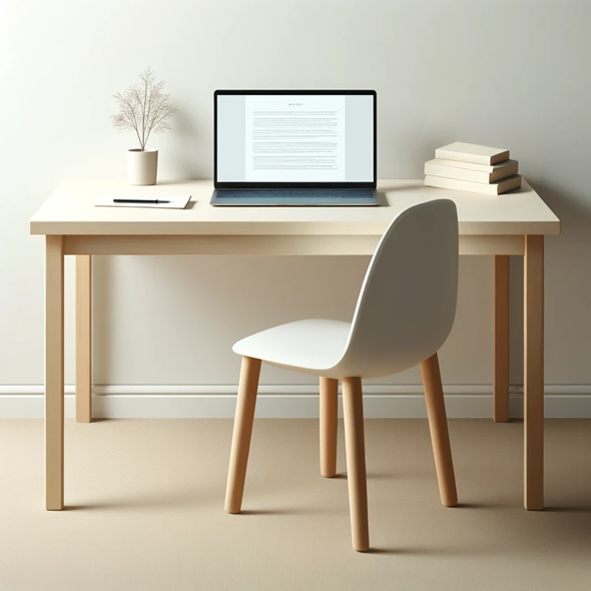
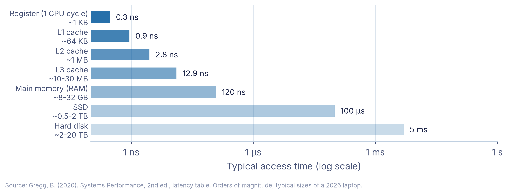
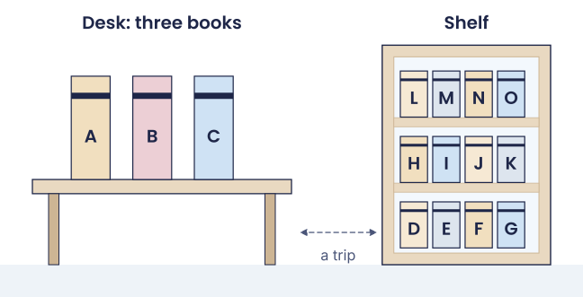
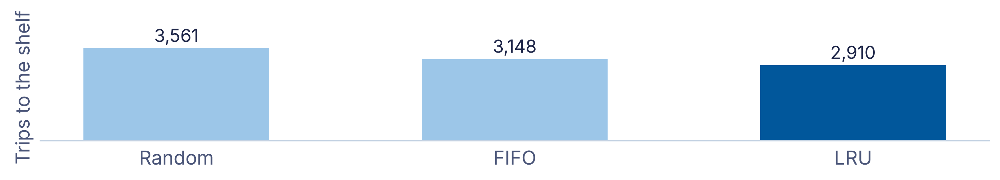
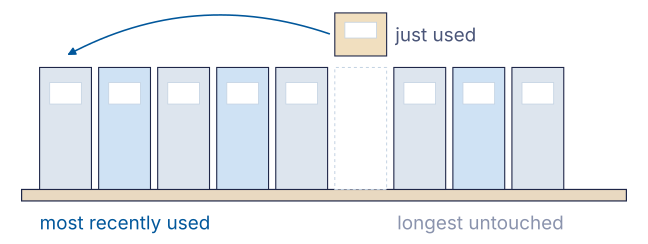
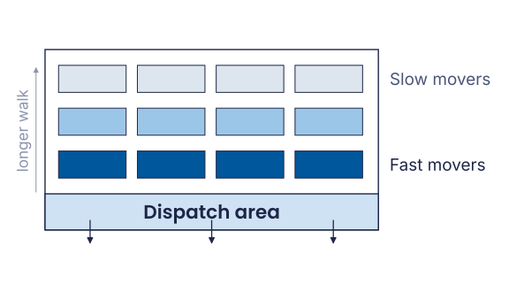
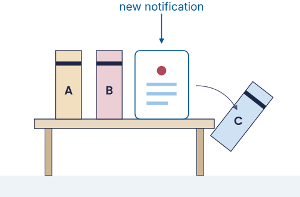

## Today in one sentence

When space is limited, keep close what you are likely to need next, and the best guide to that is what you used most recently.

Why it matters

Your cupboard is full, your desk is cluttered, your inbox overflows. Companies have the same problem: which goods sit next to the loading dock, which files stay on the fast server, which tasks get your attention today.

## Roadmap

1.  The problem: limited space, too much stuff
2.  The solution: keep what you need close, clear out the rest
3.  Your mind is a cache: protecting your attention

# The problem: limited space, too much stuff

## A quick question first

Question: **How many of you have a messy desktop right now?** Raise your hand!

Today's lecture will explain why that matters more than you think...

## A messy cupboard

Question: What would you do?

- Sort it: similar things together
- Keep what you use often within easy reach
- Now you find things faster

## Organized, but full

Question: And now?

- Get more space
- Clear out

## Why not just buy more space?

- It costs money
- Bigger storage is slower to search
- Sooner or later it fills up again

## Who else has this problem?

- Warehouses
- Computers
- Email inboxes
- Smartphones
- **Our brain?!**

## A fast processor waiting for slow memory

- Processors got faster much more quickly than memory
- Modern CPUs: billions of operations per second
- But the data doesn't arrive fast enough
- Question: How would you solve this?

- Make all memory fast? Far too expensive.
- Better: keep the data you need most **right next to the processor**.

That small, fast memory is called a **cache**.[^1]

## The cache: a hierarchy of memories

**A hierarchical memory system**

- **L1 Cache:** Tiny but ultra-fast (kilobytes)
- **L2/L3 Cache:** Larger, still fast (megabytes)
- **RAM:** Main workspace (gigabytes)
- **Storage:** Huge but slow (terabytes)

**Like a library...**

## Like a library: closer is faster and smaller

<table>
<colgroup>
<col style="width: 50%" />
<col style="width: 50%" />
</colgroup>
<tbody>
<tr>
<td style="text-align: left;">

<ul>
<li><strong>Library storage</strong> (millions of books, mass storage)</li>
<li><strong>Subject shelves</strong> (thousands of books, RAM)</li>
<li><strong>Your desk</strong> (a few borrowed books, L2)</li>
<li><strong>Short-term memory</strong> (current page, L1)</li>
</ul>

<strong>Closer = Faster = Smaller</strong>

</td>
<td style="text-align: center;">

</td>
</tr>
</tbody>
</table>

## Fast memory is small, big memory is slow

A register is roughly **ten million times faster** than a hard disk. Question: **Why not make everything that fast?**

## Why not make everything fast?

- **Physics:** larger memory sits further away, signals take longer, fast memory gets hot
- **Money:** per gigabyte, cache memory costs many times more than a hard disk
- **Solution:** several levels, each optimized for its job

## So we have to clear out. But what goes?

- True for cupboards, computers, brains...
- **But what stays and what goes?**

# The solution: keep what you need close, clear out the rest

## Roadmap

1.  The problem: limited space, too much stuff
2.  The solution: keep what you need close, clear out the rest
3.  Your mind is a cache: protecting your attention

## A desk for three books

- You study at a desk with room for **three books**
- All other books are on a shelf across the room
- Every trip to the shelf costs time
- When the desk is full and you need another book, one has to go back
- Question: Which one?

## Three ways to decide what goes

- **Random:** put back any book
- **First-In, First-Out (FIFO):** put back the book that has been on the desk the longest
- **Least Recently Used (LRU):** put back the book you haven't touched for the longest time

## Try it: which book leaves the desk?

The desk is empty. You need these books, in this order:

**A, B, C, A, D, A, B**

In pairs, 3 minutes: play it through with **FIFO** and with **LRU**. Count your trips to the shelf.

## FIFO: six trips to the shelf

| Request | Desk afterwards  | Trip? |
|---------|------------------|-------|
| A       | A                | yes   |
| B       | A B              | yes   |
| C       | A B C            | yes   |
| A       | A B C            | no    |
| D       | B C D (A leaves) | yes   |
| A       | C D A (B leaves) | yes   |
| B       | D A B (C leaves) | yes   |

FIFO throws out A, the book we use all the time.

## LRU: five trips to the shelf

| Request | Desk afterwards  | Trip? |
|---------|------------------|-------|
| A       | A                | yes   |
| B       | A B              | yes   |
| C       | A B C            | yes   |
| A       | A B C            | no    |
| D       | A C D (B leaves) | yes   |
| A       | A C D            | no    |
| B       | A D B (C leaves) | yes   |

LRU keeps A, because we just used it.

## And Random?

Question: Would you clear out your cupboard by throwing out things at random?

Computer scientists call a trip to the shelf a **miss**, and finding the book on the desk a **hit**.

In the tutorial, you build this yourself.

## The perfect strategy needs a crystal ball

- **Optimal: Clairvoyance**
  - Keep what you'll need
  - Remove what you won't
- Question: What's the problem?

**→ Requires knowledge of the future!**

## LRU works because the recent past predicts the near future

- **Least Recently Used (LRU)** is the dominant strategy
- Question: Why is this the better strategy?
- **Temporal locality:** what you used recently, you will likely need again soon
- Books on your desk, apps opened today, people texted this morning
- In Belady's classic comparison, LRU came closest to the crystal ball[^2]

## The pile on your desk is not a mess

- The economist Yukio Noguchi files everything in one row: whatever he used goes back to the **left end**
- So the most recently used files are always in front
- A pile does the same: what you used last lies on top
- Proven: searching such a row from the front never takes more than **twice as long** as the best possible order[^3]

## Keep it close: caching in logistics

Question: Where do you see this in a warehouse or a supermarket?

- **Warehouses:** fast-moving goods sit next to the dispatch area
- **Retail:** goods are stored in regional warehouses close to the customer
- **Streaming:** popular films are kept on servers in your region

This is **spatial locality**: keep things where they are used.

# Your mind is a cache: protecting your attention

## Roadmap

1.  The problem: limited space, too much stuff
2.  The solution: keep what you need close, clear out the rest
3.  Your mind is a cache: protecting your attention

## Forgetting is a feature

- Hermann Ebbinghaus measured how memory fades over time: the **forgetting curve**
- One reading: the brain runs out of space
- A better one: the brain keeps close what you will likely need again
- What you haven't used for a long time gets harder to reach, just like LRU[^4]

## Your attention is a desk for three books

- Only a few things fit into your attention at once
- Every notification puts a new book on the desk
- And pushes another one off
- You did not choose which one

## Flooding and poisoning

- **Flooding:** so many notifications that what matters gets pushed out. That is distraction.
- **Poisoning:** false information lands on your desk and you rely on it without checking. That is misinformation.
- Both work because attention is small and we trust what is right in front of us.

## Getting it back is expensive

- After an interruption, it often takes **20+ minutes** to get back on track[^5]
- Like a trip to the slowest memory: millions of times more expensive than staying at the desk
- Technology and social media are **designed** to capture attention

Reflection: How many times did you check your phone during this lecture?

## What gets evicted: first the task, then your goals, then your values

- **Spotlight:** what you are doing right now
- **Starlight:** your goals for this year
- **Daylight:** your values, who you want to be[^6]

LRU evicts what you haven't touched for a long time. If your attention always goes to notifications, you first lose the task, then your goals, and in the end, Williams argues, yourself.

## What to do about it

- **Fewer interruptions:** notifications off while you work, one thing at a time
- **Choose what gets in:** be selective with news and feeds
- **Touch what matters:** revisit your goals regularly, so they don't get evicted

**Want to dive deeper?** Rolf Dobelli, *The Not To-Do List*, chapters 15, 46, 51 and 52. Johann Hari, *Stolen Focus*. And because news is a big source of distraction: Rolf Dobelli, *Stop Reading the News*.

## Self-assessment

Question: **Right now:**

1.  How many browser tabs do you have open? \_\_\_
2.  How many notifications did you receive in the last hour? \_\_\_
3.  How many unread emails in your inbox? \_\_\_

**Do you see any risks of cache flooding?**

## One last check

Your desk holds three books. You need **C, A, B, C, D**.

Question: Which book leaves the desk under LRU when D arrives?

**A.** C was just used, B came after A, so A is the one you haven't touched for the longest time.

## What we covered

The problem: limited space, too much stuff

Every storage system faces the same question: what to keep close and what to clear out.

The solution: keep what you need close, clear out the rest

Fast storage is always small, so we need a rule for clearing out. Least Recently Used works because the recent past predicts the near future.

Your mind is a cache: protecting your attention

Your attention works like a cache: small, valuable and easily flooded, so protect it.

## Why it matters

Your cupboard is full, your desk is cluttered, your inbox overflows. Companies have the same problem: which goods sit next to the loading dock, which files stay on the fast server, which tasks get your attention today.

## 

What you used last, you'll need next.

# Literature

## Interesting literature to start

- Christian, B., & Griffiths, T. (2016). Algorithms to live by: the computer science of human decisions. First international edition. New York, Henry Holt and Company.[^7]

## Books on Programming

- Downey, A. B. (2024). Think Python: How to think like a computer scientist (Third edition). O'Reilly. [Free online](https://greenteapress.com/wp/think-python-3rd-edition/)
- Elter, S. (2021). Schrödinger programmiert Python: Das etwas andere Fachbuch (1. Auflage). Rheinwerk Verlag.

> **Note**
>
> Think Python is free online and a great start. Schrödinger programmiert Python is a playful alternative in German.

## More Literature

For more interesting literature, take a look at the [literature list](../general/literature.qmd) of this course.

[^1]: Burks, A. W., Goldstine, H. H., & von Neumann, J. (1946). Preliminary discussion of the logical design of an electronic computing instrument. Wilkes, M. V. (1965). Slave memories and dynamic storage allocation. Wulf, W. A., & McKee, S. A. (1995). Hitting the memory wall. See also Christian & Griffiths (2016), ch. 4.

[^2]: Belady, L. A. (1966). A study of replacement algorithms for a virtual-storage computer. IBM Systems Journal, 5(2), 78--101; see also Christian & Griffiths (2016), ch. 4. In Tutorial III.III you measure LRU against random eviction yourself.

[^3]: Sleator, D. D. & Tarjan, R. E. (1985). Amortized efficiency of list update and paging rules. Communications of the ACM, 28(2); see also Christian & Griffiths (2016), ch. 4.

[^4]: Anderson, J. R. & Schooler, L. J. (1991). Reflections of the environment in memory. Psychological Science, 2(6); see also Christian & Griffiths (2016), ch. 4.

[^5]: Order of magnitude from Gloria Mark's workplace studies, e.g. Mark, G., Gonzalez, V. M., & Harris, J. (2005). No task left behind? Examining the nature of fragmented work. CHI 2005.

[^6]: Williams, J. (2018). Stand Out of Our Light. Cambridge University Press; quoted in Hari, J. (2022). Stolen Focus.

[^7]: The main inspiration for this lecture. We have read it and discussed it in depth, always wanting to translate it into a course.
