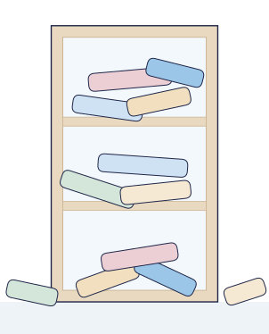
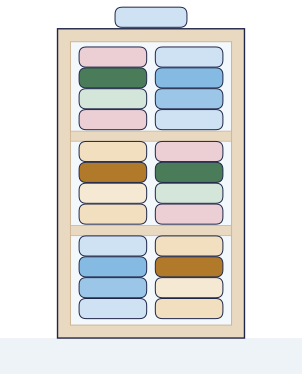
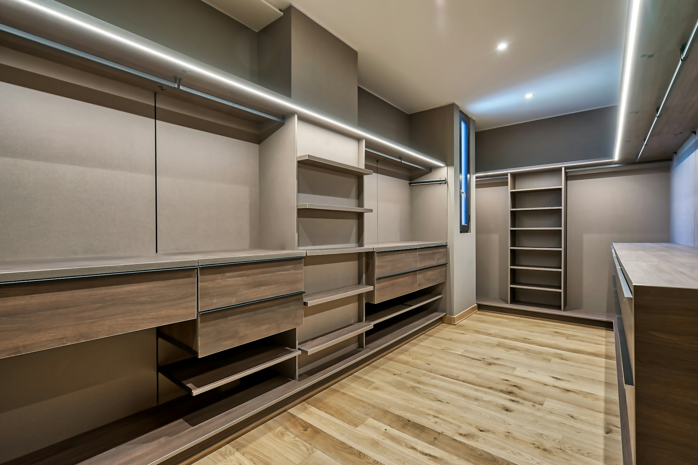
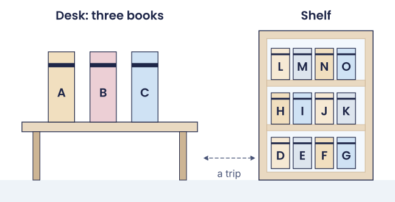
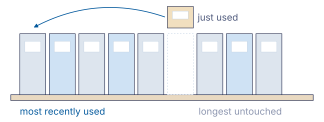
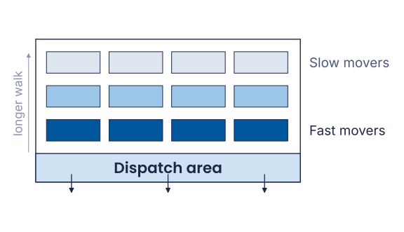
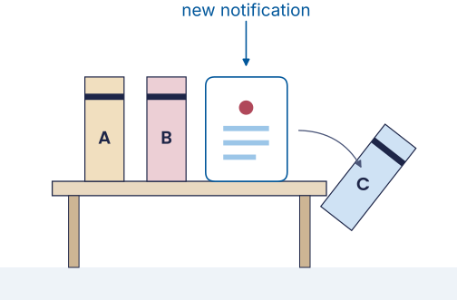

```{python}
#| include: false
import sys
sys.path.insert(0, "../helpers")
import matplotlib.pyplot as plt
from course_plots import use_course_style, latency_ladder
use_course_style()

# (level, typical access time in ns, typical size), orders of magnitude
memory_levels = [
    ("Register (1 CPU cycle)", 0.3, "~1 KB"),
    ("L1 cache", 0.9, "~64 KB"),
    ("L2 cache", 2.8, "~1 MB"),
    ("L3 cache", 12.9, "~10-30 MB"),
    ("Main memory (RAM)", 120, "~8-32 GB"),
    ("SSD", 100_000, "~0.5-2 TB"),
    ("Hard disk", 5_000_000, "~2-20 TB"),
]
```

## Today in one sentence {.lecture-opening}

::: {.lecture-summary}
[When space is limited, keep close what you are likely to need next, and the best guide to that is what you used most recently.]{.statement}
:::

::: {.lecture-why}
[Why it matters]{.eyebrow}

Your cupboard is full, your desk is cluttered, your inbox overflows. Companies have the same problem: which goods sit next to the loading dock, which files stay on the fast server, which tasks get your attention today.
:::

## Roadmap {.lecture-opening}

::: {.roadmap}
1. [The problem: limited space, too much stuff]{.roadmap-item .future}
2. [The solution: keep what you need close, clear out the rest]{.roadmap-item .future}
3. [Your mind is a cache: protecting your attention]{.roadmap-item .future}
:::

# [The problem: limited space, too much stuff]{.flow} {.title visibility="hidden"}

## A quick question first

:::{.fragment}
[Question:]{.question} **How many of you have a messy desktop right now?** Raise your hand!

:::

:::{.fragment}
Today's lecture will explain why that matters more than you think...
:::

## A messy cupboard

::: {.columns}
::: {.column width="55%"}
[Question:]{.question} What would you do?

:::{.incremental}
- Sort it: similar things together
- Keep what you use often within easy reach
- Now you find things faster
:::
:::
::: {.column width="45%"}
::: {style="text-align: center;"}
{height="420"}
:::
:::
:::

## Organized, but full

::: {.columns}
::: {.column width="55%"}
[Question:]{.question} And now?

:::{.incremental}
- Get more space
- Clear out
:::
:::
::: {.column width="45%"}
::: {style="text-align: center;"}
{height="420"}
:::
:::
:::

::: {.notes}
Better organization helps, but every storage has a finite capacity. More space helps, but it has limits too. Sooner or later we are left with the second option: clearing out. The rest of the lecture is about how to do that well.
:::

## Why not just buy more space?

::: {.columns}
::: {.column width="50%"}
:::{.incremental}
- It costs money
- Bigger storage is slower to search
- Sooner or later it fills up again
:::
:::
::: {.column width="50%"}
::: {style="text-align: center;"}

:::
:::
:::

::: {.notes}
The trade-off behind the second point: size versus speed. The larger a storage, the longer it takes to find a thing in it. That holds for a cupboard, a warehouse and, as we will see, for computer memory.
:::

## Who else has this problem?

:::{.incremental}
- Warehouses
- Computers
- Email inboxes
- Smartphones
- **Our brain?!**
:::

## A fast processor waiting for slow memory

:::{.incremental}
- Processors got faster much more quickly than memory
- Modern CPUs: billions of operations per second
- But the data doesn't arrive fast enough
- [Question:]{.question} How would you solve this?
:::

:::{.incremental}
- Make all memory fast? Far too expensive.
- Better: keep the data you need most **right next to the processor**.
:::

::: {.fragment .fade-in}
That small, fast memory is called a **cache**.[^hierarchy]
:::

[^hierarchy]: Burks, A. W., Goldstine, H. H., & von Neumann, J. (1946). Preliminary discussion of the logical design of an electronic computing instrument. Wilkes, M. V. (1965). Slave memories and dynamic storage allocation. Wulf, W. A., & McKee, S. A. (1995). Hitting the memory wall. See also Christian & Griffiths (2016), ch. 4.

::: {.notes}
The evolution of computer memory: computer science faced the same storage problem as our cupboard. In 1946 von Neumann's team already expected a hierarchy of memories. Processors then became faster much more quickly than memory (Moore's Law, 1965), so in 1965 Maurice Wilkes proposed a small, fast memory close to the processor (he called it a "slave memory"), the first cache. In 1995 Wulf and McKee called the growing gap the "Memory Wall". The waiting itself is often called the von Neumann bottleneck, a term coined by John Backus in 1977.
:::

## The cache: a hierarchy of memories

:::{.fragment}
**A hierarchical memory system**
:::

:::{.incremental}
- **L1 Cache:** Tiny but ultra-fast (kilobytes)
- **L2/L3 Cache:** Larger, still fast (megabytes)
- **RAM:** Main workspace (gigabytes)
- **Storage:** Huge but slow (terabytes)

:::{.fragment}
**Like a library...**
:::
:::

## Like a library: closer is faster and smaller

:::{.incremental}
::: {layout="[[50,50]]"}
::: {.column width="50%"}
- **Library storage** (millions of books, mass storage)
- **Subject shelves** (thousands of books, RAM)
- **Your desk** (a few borrowed books, L2)
- **Short-term memory** (current page, L1)

:::{.fragment}
**Closer = Faster = Smaller**
:::
:::
::: {.column width="50%"}

:::
:::
:::

## Fast memory is small, big memory is slow

```{python}
#| echo: false
fig = latency_ladder(memory_levels, source="Source: Gregg, B. (2020). Systems Performance, 2nd ed., latency table. Orders of magnitude, typical sizes of a 2026 laptop.")
plt.show()
```

A register is roughly **ten million times faster** than a hard disk. [Question:]{.question} **Why not make everything that fast?**

## Why not make everything fast?

:::{.incremental}
- **Physics:** larger memory sits further away, signals take longer, fast memory gets hot
- **Money:** per gigabyte, cache memory costs many times more than a hard disk
- **Solution:** several levels, each optimized for its job
:::

::: {.notes}
Physical limits: larger memory sits further from the CPU, signals take longer to travel, and dense fast memory produces heat that must be dissipated. Economic limits: per gigabyte, fast cache memory costs many orders of magnitude more than a hard disk. The solution is a hierarchy with multiple cache levels, each optimized for different needs.
:::

## So we have to clear out. But what goes?

:::{.incremental}
- True for cupboards, computers, brains...
- **But what stays and what goes?**
:::

# [The solution: keep what you need close, clear out the rest]{.flow} {.title visibility="hidden"}

## Roadmap {.section-roadmap}

::: {.roadmap}
1. [The problem: limited space, too much stuff]{.roadmap-item .done}
2. [The solution: keep what you need close, clear out the rest]{.roadmap-item .current}
3. [Your mind is a cache: protecting your attention]{.roadmap-item .future}
:::

## A desk for three books

::: {.columns}
::: {.column width="55%"}
:::{.incremental}
- You study at a desk with room for **three books**
- All other books are on a shelf across the room
- Every trip to the shelf costs time
- When the desk is full and you need another book, one has to go back
- [Question:]{.question} Which one?
:::
:::
::: {.column width="45%"}

:::
:::

::: {.notes}
This desk is our model for the whole lecture. The desk is the cache: small and fast. The shelf is the big, slow storage. A trip to the shelf is a cache miss. The question "which book goes back?" is the eviction problem.
:::

## Three ways to decide what goes

:::{.incremental}
- **Random:** put back any book
- **First-In, First-Out (FIFO):** put back the book that has been on the desk the longest
- **Least Recently Used (LRU):** put back the book you haven't touched for the longest time
:::

## Try it: which book leaves the desk?

The desk is empty. You need these books, in this order:

**A, B, C, A, D, A, B**

. . .

In pairs, 3 minutes: play it through with **FIFO** and with **LRU**. Count your trips to the shelf.

## FIFO: six trips to the shelf

::: {.content-visible when-format="revealjs"}
```{=html}
<table>
<thead>
<tr><th>Request</th><th>Desk afterwards</th><th>Trip?</th></tr>
</thead>
<tbody>
<tr class="fragment"><td>A</td><td>A</td><td>yes</td></tr>
<tr class="fragment"><td>B</td><td>A B</td><td>yes</td></tr>
<tr class="fragment"><td>C</td><td>A B C</td><td>yes</td></tr>
<tr class="fragment"><td>A</td><td>A B C</td><td>no</td></tr>
<tr class="fragment"><td>D</td><td>B C D (A leaves)</td><td>yes</td></tr>
<tr class="fragment"><td>A</td><td>C D A (B leaves)</td><td>yes</td></tr>
<tr class="fragment"><td>B</td><td>D A B (C leaves)</td><td>yes</td></tr>
</tbody>
</table>
```
:::

::: {.content-visible unless-format="revealjs"}
| Request | Desk afterwards | Trip? |
|---------|-----------------|-------|
| A | A | yes |
| B | A B | yes |
| C | A B C | yes |
| A | A B C | no |
| D | B C D (A leaves) | yes |
| A | C D A (B leaves) | yes |
| B | D A B (C leaves) | yes |
:::

::: {.fragment .fade-in}
FIFO throws out A, the book we use all the time.
:::

## LRU: five trips to the shelf

::: {.content-visible when-format="revealjs"}
```{=html}
<table>
<thead>
<tr><th>Request</th><th>Desk afterwards</th><th>Trip?</th></tr>
</thead>
<tbody>
<tr class="fragment"><td>A</td><td>A</td><td>yes</td></tr>
<tr class="fragment"><td>B</td><td>A B</td><td>yes</td></tr>
<tr class="fragment"><td>C</td><td>A B C</td><td>yes</td></tr>
<tr class="fragment"><td>A</td><td>A B C</td><td>no</td></tr>
<tr class="fragment"><td>D</td><td>A C D (B leaves)</td><td>yes</td></tr>
<tr class="fragment"><td>A</td><td>A C D</td><td>no</td></tr>
<tr class="fragment"><td>B</td><td>A D B (C leaves)</td><td>yes</td></tr>
</tbody>
</table>
```
:::

::: {.content-visible unless-format="revealjs"}
| Request | Desk afterwards | Trip? |
|---------|-----------------|-------|
| A | A | yes |
| B | A B | yes |
| C | A B C | yes |
| A | A B C | no |
| D | A C D (B leaves) | yes |
| A | A C D | no |
| B | A D B (C leaves) | yes |
:::

::: {.fragment .fade-in}
LRU keeps A, because we just used it.
:::

## And Random?

[Question:]{.question} Would you clear out your cupboard by throwing out things at random?

```{python}
#| echo: false
import numpy as np
from course_plots import trips_bar_chart

# A desk for 3 books, 20 different books, 10,000 requests. Recently used books
# are requested again with higher probability (temporal locality).
BOOKS, CAPACITY, REQUESTS, RECENT_SHARE, RECENT_MEMORY, DECAY = 20, 3, 10_000, 0.75, 6, 0.5
rng = np.random.default_rng(42)
recent, requests = [], []
for _ in range(REQUESTS):
    if recent and rng.random() < RECENT_SHARE:
        weights = np.array([DECAY ** i for i in range(len(recent))])
        book = int(rng.choice(recent, p=weights / weights.sum()))  # recent[0] = most recent
    else:
        book = int(rng.integers(BOOKS))
    requests.append(book)
    if book in recent:
        recent.remove(book)
    recent.insert(0, book)
    recent = recent[:RECENT_MEMORY]

def trips_to_shelf(policy):
    evict_rng = np.random.default_rng(42)
    desk, trips = [], 0
    for book in requests:
        if book in desk:
            if policy == "LRU":
                desk.remove(book)
                desk.append(book)
            continue
        trips += 1
        if len(desk) == CAPACITY:
            desk.pop(int(evict_rng.integers(CAPACITY)) if policy == "Random" else 0)
        desk.append(book)
    return trips

trips = {p: trips_to_shelf(p) for p in ("Random", "FIFO", "LRU")}
assert trips["LRU"] < trips["FIFO"] < trips["Random"]
fig = trips_bar_chart(trips, width=9.5, height=1.7)
plt.show()
```

. . .

Computer scientists call a trip to the shelf a **miss**, and finding the book on the desk a **hit**.

. . .

In the tutorial, you build this yourself.

::: {.notes}
Simulation: a desk for three books, 20 different books, 10,000 requests. A book that was used recently is requested again with higher probability, like in real life. Random eviction needs the most trips to the shelf, FIFO fewer, LRU the fewest. Random is not terrible, but it ignores everything we know about what comes next.
:::

## The perfect strategy needs a crystal ball

:::{.incremental}
- **Optimal: Clairvoyance**
    - Keep what you'll need
    - Remove what you won't
- [Question:]{.question} What's the problem?

:::{.fragment}
**→ Requires knowledge of the future!**
:::
:::

## LRU works because the recent past predicts the near future

:::{.incremental}
- **Least Recently Used (LRU)** is the dominant strategy
- [Question:]{.question} Why is this the better strategy?
- **Temporal locality:** what you used recently, you will likely need again soon
- Books on your desk, apps opened today, people texted this morning
- In Belady's classic comparison, LRU came closest to the crystal ball[^belady]
:::

[^belady]: Belady, L. A. (1966). A study of replacement algorithms for a virtual-storage computer. IBM Systems Journal, 5(2), 78–101; see also Christian & Griffiths (2016), ch. 4. In Tutorial III.III you measure LRU against random eviction yourself.

## The pile on your desk is not a mess

:::{.incremental}
- The economist Yukio Noguchi files everything in one row: whatever he used goes back to the **left end**
- So the most recently used files are always in front
- A pile does the same: what you used last lies on top
- Proven: searching such a row from the front never takes more than **twice as long** as the best possible order[^sleator]
:::

{fig-align="center" height="180"}

[^sleator]: Sleator, D. D. & Tarjan, R. E. (1985). Amortized efficiency of list update and paging rules. Communications of the ACM, 28(2); see also Christian & Griffiths (2016), ch. 4.

## Keep it close: caching in logistics

[Question:]{.question} Where do you see this in a warehouse or a supermarket?

::: {.columns}
::: {.column width="58%"}
:::{.incremental}
- **Warehouses:** fast-moving goods sit next to the dispatch area
- **Retail:** goods are stored in regional warehouses close to the customer
- **Streaming:** popular films are kept on servers in your region
:::
:::
::: {.column width="42%"}

:::
:::

::: {.fragment .fade-in}
This is **spatial locality**: keep things where they are used.
:::

::: {.notes}
Examples from Christian & Griffiths (2016), ch. 4.
:::

# [Your mind is a cache: protecting your attention]{.flow} {.title visibility="hidden"}

## Roadmap {.section-roadmap}

::: {.roadmap}
1. [The problem: limited space, too much stuff]{.roadmap-item .done}
2. [The solution: keep what you need close, clear out the rest]{.roadmap-item .done}
3. [Your mind is a cache: protecting your attention]{.roadmap-item .current}
:::

## Forgetting is a feature

:::{.incremental}
- Hermann Ebbinghaus measured how memory fades over time: the **forgetting curve**
- One reading: the brain runs out of space
- A better one: the brain keeps close what you will likely need again
- What you haven't used for a long time gets harder to reach, just like LRU[^anderson]
:::

[^anderson]: Anderson, J. R. & Schooler, L. J. (1991). Reflections of the environment in memory. Psychological Science, 2(6); see also Christian & Griffiths (2016), ch. 4.

## Your attention is a desk for three books

:::{.incremental}
- Only a few things fit into your attention at once
- Every notification puts a new book on the desk
- And pushes another one off
- You did not choose which one
:::

{fig-align="center" height="260"}

## Flooding and poisoning

:::{.incremental}
- **Flooding:** so many notifications that what matters gets pushed out. That is distraction.
- **Poisoning:** false information lands on your desk and you rely on it without checking. That is misinformation.
- Both work because attention is small and we trust what is right in front of us.
:::

::: {.notes}
The terms come from computer security. Cache flooding is a form of Denial-of-Service attack: the system is overloaded with requests, important data is evicted, the system slows down or crashes. Cache poisoning plants false data in a cache, so later requests are answered with wrong content; DNS cache poisoning, for example, sends users to a fake website. Both exploit that a cache is small and is trusted without checking the original source.
:::

## Getting it back is expensive

:::{.incremental}
- After an interruption, it often takes **20+ minutes** to get back on track[^mark]
- Like a trip to the slowest memory: millions of times more expensive than staying at the desk
- Technology and social media are **designed** to capture attention
:::

::: {.fragment .fade-in}
[Reflection:]{.question} How many times did you check your phone during this lecture?
:::

[^mark]: Order of magnitude from Gloria Mark's workplace studies, e.g. Mark, G., Gonzalez, V. M., & Harris, J. (2005). No task left behind? Examining the nature of fragmented work. CHI 2005.

::: {.notes}
Five productivity killers, in cache terms. Overload: too much information at once, the cache capacity is exceeded. Exhaustion: too long without clearing out. Context switching: every interruption of flow costs often 20 minutes or more to get back on track. Distraction: cache flooding by constant notifications and social media. Misinformation: cache poisoning by fake news and misleading information. The result is less creativity, less critical thinking and less productivity.
:::

## What gets evicted: first the task, then your goals, then your values

:::{.incremental}
- **Spotlight:** what you are doing right now
- **Starlight:** your goals for this year
- **Daylight:** your values, who you want to be[^williams]
:::

::: {.fragment .fade-in}
LRU evicts what you haven't touched for a long time. If your attention always goes to notifications, you first lose the task, then your goals, and in the end, Williams argues, yourself.
:::

[^williams]: Williams, J. (2018). Stand Out of Our Light. Cambridge University Press; quoted in Hari, J. (2022). Stolen Focus.

::: {.notes}
The three levels come from James Williams, a former Google strategist, quoted in Johann Hari's "Stolen Focus". Spotlight: immediate goals, your focus, what are you working on right now? Starlight: medium-term goals, your wishes, what matters this year? Daylight: long-term goals, your values, what defines your life direction?
:::

## What to do about it

:::{.incremental}
- **Fewer interruptions:** notifications off while you work, one thing at a time
- **Choose what gets in:** be selective with news and feeds
- **Touch what matters:** revisit your goals regularly, so they don't get evicted
:::

::: {.fragment .fade-in}
**Want to dive deeper?** Rolf Dobelli, *The Not To-Do List*, chapters 15, 46, 51 and 52. Johann Hari, *Stolen Focus*. And because news is a big source of distraction: Rolf Dobelli, *Stop Reading the News*.
:::

::: {.notes}
More tips, in cache terms. Prioritize sleep, nutrition and mindful habits: they maintain cache performance. Take breaks: regular clearing out prevents exhaustion. Time-box your work: structure prevents overflow. Create protected time for deep work and a dedicated workspace: that prevents cache flooding. Meditation and exercise are maintenance routines for the cache. Treat your desk as a cache hierarchy: hot cache on the desk with only today's tasks, warm cache in a nearby shelf or drawer with this week's projects, cold storage in the archive or closet for everything else. If you haven't used it recently, move it away. Distraction can hardly be avoided in today's world, especially for managers, but it can be reduced, and awareness is the first step.
:::

## Self-assessment

[Question:]{.question} **Right now:**

:::{.incremental}
1. How many browser tabs do you have open? ___
2. How many notifications did you receive in the last hour? ___
3. How many unread emails in your inbox? ___

:::{.fragment}
**Do you see any risks of cache flooding?**
:::
:::

## One last check

Your desk holds three books. You need **C, A, B, C, D**.

. . .

[Question:]{.question} Which book leaves the desk under LRU when D arrives?

::: {.fragment .fade-in}
**A.** C was just used, B came after A, so A is the one you haven't touched for the longest time.
:::

## What we covered {.lecture-closing}

::: {.covered-list}
::: {.covered-item}
[The problem: limited space, too much stuff]{.eyebrow}

Every storage system faces the same question: what to keep close and what to clear out.
:::

::: {.covered-item}
[The solution: keep what you need close, clear out the rest]{.eyebrow}

Fast storage is always small, so we need a rule for clearing out. Least Recently Used works because the recent past predicts the near future.
:::

::: {.covered-item}
[Your mind is a cache: protecting your attention]{.eyebrow}

Your attention works like a cache: small, valuable and easily flooded, so protect it.
:::

:::

## Why it matters {.lecture-closing}

::: {.lecture-why .closing}
Your cupboard is full, your desk is cluttered, your inbox overflows. Companies have the same problem: which goods sit next to the loading dock, which files stay on the fast server, which tasks get your attention today.
:::

## {.loud-slide .lecture-key}

::: {.r-fit-text}
What you used last, you'll need next.
:::

::: {.notes}
Key takeaways, the concepts: caching is universal, it applies to computers, organizations and human cognition. The fundamental trade-off: fast storage is small, large storage is slow. LRU works because of temporal locality, the recent past predicts the near future. Key takeaways for your life: your brain is a cache, with limited capacity, vulnerable to flooding and poisoning. Protect your attention, it is your scarcest and most valuable resource. Apply caching principles to life: keep what you use, remove what you don't.
:::




