<script  src="../site_libs/quarto-diagram/mermaid.min.js"></script>
<script  src="../site_libs/quarto-diagram/mermaid-init.js"></script>
<link  href="../site_libs/quarto-diagram/mermaid.css" rel="stylesheet" />

## Today in one sentence

<span class="statement">There is no single best order for your tasks: first decide what you want to achieve, and the right rule follows.</span>

<span class="eyebrow">Why it matters</span>

Monday morning, ten tasks on your list: where do you start? Companies face the same question at scale: which order on the production line, which customer order first, which project gets the team this week.

## Roadmap

1.  <span class="roadmap-item future">The basics: when order matters, and when it doesn't</span>
2.  <span class="roadmap-item future">Your goal decides the rule: deadlines, waiting time, value</span>
3.  <span class="roadmap-item future">Real life: dependencies, interruptions and thrashing</span>

# <span class="flow">The basics: when order matters, and when it doesn't</span>

## Four loads of laundry, one washer, one dryer

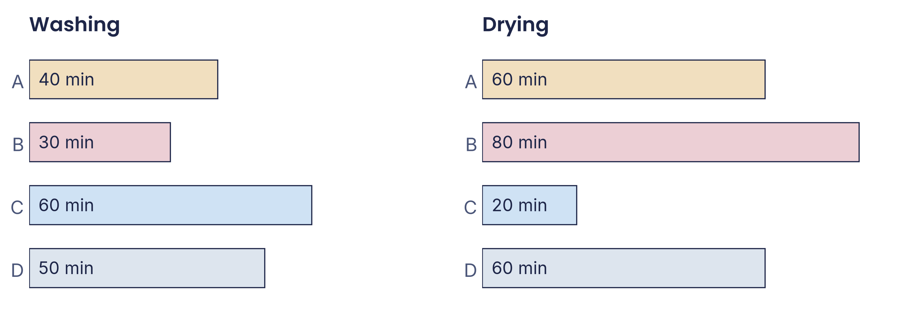

## Goal: all laundry done as early as possible

``` python
Task  Washing  Drying
  A    40min   60min
  B    30min   80min
  C    60min   20min
  D    50min   60min
```

<span class="highlight">Goal:</span> **Minimize total time for washing and drying all loads**

<span class="question">Question:</span> **An idea how to solve this?**

## Johnson's rule: shortest job first or last

<span class="task">Rule:</span> To find the <span class="highlight">optimal solution</span>:

1.  Find the job with **shortest duration**:
    - If on **Machine 1** → Schedule First
    - If on **Machine 2** → Schedule Last
    - If **equal** → Choose randomly
2.  Remove job from list and **repeat**

## Applying Johnson's Rule

``` python
Task  Washing  Drying  Schedule
  A    40min   60min
  B    30min   80min
  C    60min   20min
  D    50min   60min
```

<span class="question">Question:</span> **What's the first scheduled task?**

## Applying Johnson's Rule

``` python
Task  Washing  Drying  Schedule
  A    40min   60min
  B    30min   80min
  C    60min   20min        4
  D    50min   60min
```

- **In Task C**, the dryer is the **shortest** task.
- It is on **Machine 2** → **Schedule Last**

<span class="question">Question:</span> **What's the next task?**

## Applying Johnson's Rule

``` python
Task  Washing  Drying  Schedule
  A    40min   60min
  B    30min   80min        1
  C    60min   20min        4
  D    50min   60min
```

- **In Task B**, the washing machine is the **shortest** task.
- It is on **Machine 1** → **Schedule First**

<span class="question">Question:</span> **What's the next task?**

## Applying Johnson's Rule

``` python
Task  Washing  Drying  Schedule
  A    40min   60min        2
  B    30min   80min        1
  C    60min   20min        4
  D    50min   60min
```

- **In Task A**, the washing machine is the **shortest** task.
- It is on **Machine 1** → **Schedule Second**

<span class="highlight">Now, we only have one task left!</span>

## Applying Johnson's Rule

``` python
Task  Washing  Drying  Schedule
  A    40min   60min        2
  B    30min   80min        1
  C    60min   20min        4
  D    50min   60min        3
```

**Final sequence: <span class="highlight">B A D C</span>**

## Optimal Solution

**Optimal Solution: <span class="highlight">B A D C</span>**

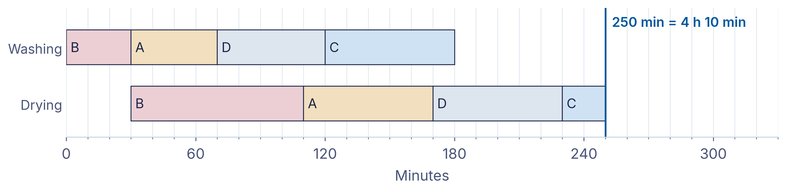

**Total time:** 4 hours 10 minutes

<span class="question">Question:</span> **Is there a worse solution?**

## Suboptimal Solution

**Suboptimal Solution: <span class="highlight">C D A B</span>**

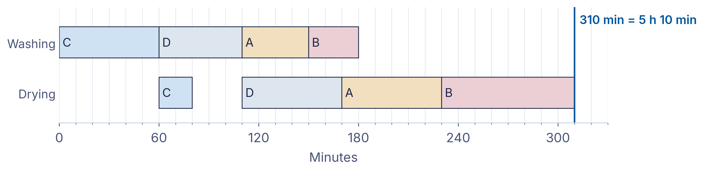

**Total time:** 5 hours 10 minutes

<span class="question">Question:</span> **What's the difference?**

## <span class="invert-font">Industrialization</span>

- First systematic visualization by Frederick Taylor
- Henry Gantt develops the Gantt Chart around 1910
- Key tool of industrial production planning
- But no scheduling theory yet!

<span class="highlight">Question:</span> **Who knows what a Gantt Chart is?**

## <span class="invert-font">Modern Scheduling Theory</span>

- RAND Corporation founded (1948)
- Selmer Johnson publishes Johnson's Rule in 1954
- Beginning of modern scheduling theory
- Many more algorithms and methods developed since

## Scheduling is everywhere in professional practice

- **Project management:** task dependencies, resource allocation
- **Software:** CPU, threads, job queues
- **Operations:** production, supply chain
- **Healthcare:** patients, surgeries, staff
- **Transportation:** routes, crews, maintenance

## Tasks differ in time and in relationships

<span class="question">Question:</span> **What properties can scheduled tasks have?**

<figure class=''>

<pre class="mermaid mermaid-js">mindmap
  root((Task Properties))
    Time-Related
      Time windows
      Deadlines
      Start constraints
      Deterministic durations
      Variable durations
      Stochastic durations
    Relationship-Based
      Predecessor relationships
      Successor relationships
      Dependencies
      Priority levels
      Resource constraints
</pre>

</figure>

## Which tasks do you deal with?

<span class="question">Question:</span> **What types of tasks do you deal with most often?**

## One person instead of two machines

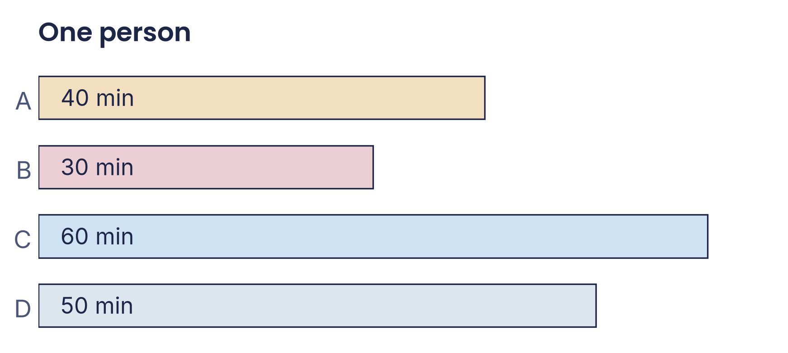

<span class="question">Question:</span> **What is different from before?**

## For total time alone, the order doesn't matter

> **Note**
>
> With one person and no deadlines, every order takes the same **total time**.

<span class="question">Question:</span> **But is it that simple?**

> **Important**
>
> Order becomes crucial with **deadlines, priorities and dependencies**.

## The basics: when order matters, and when it doesn't

<span class="eyebrow">What we covered</span>

<span class="statement">Sometimes the order of tasks changes the result, sometimes it doesn't. Knowing which saves time.</span>

# <span class="flow">Your goal decides the rule: deadlines, waiting time, value</span>

## Roadmap

1.  <span class="roadmap-item done">The basics: when order matters, and when it doesn't</span>
2.  <span class="roadmap-item current">Your goal decides the rule: deadlines, waiting time, value</span>
3.  <span class="roadmap-item future">Real life: dependencies, interruptions and thrashing</span>

## Goal 1: nobody waits too long past the deadline

Tasks with individual deadlines:

``` python
Task  Duration  Deadline
  A    40min    110min
  B    30min     90min
  C    60min    150min
  D    50min     70min
  E    30min    210min
```

<span class="highlight">Goal:</span> **Minimize maximum deadline violation**

<span class="question">Question:</span> **An idea how to solve this?**

## Earliest Due Date: sort by deadline

<span class="task">Rule:</span> Sort the tasks by deadline (**EDD**).

``` python
Task  Duration  Deadline
  A    40min    110min
  B    30min     90min
  C    60min    150min
  D    50min     70min
  E    30min    210min
```

``` python
Task  Duration  Deadline
  D    50min     70min
  B    30min     90min
  A    40min    110min
  C    60min    150min
  E    30min    210min
```

<span class="highlight">Let's visualize this!</span>

## The EDD schedule

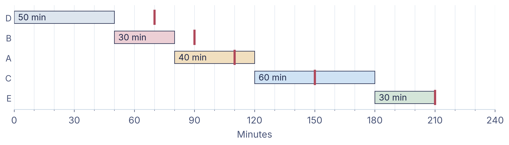

Red marks: deadlines.

<span class="question">Question:</span> **What's the maximum delay here?**

## Goal 2: as little waiting as possible

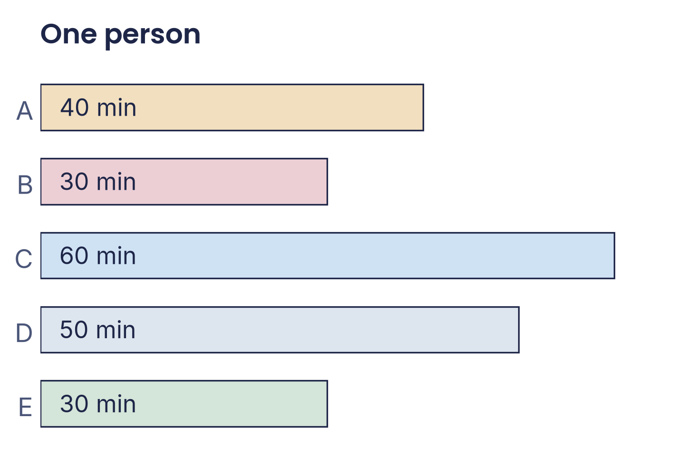

Instead of deadlines, we now have **processing times.**

<span class="fragment"><span class="highlight">Goal:</span> Min. total waiting time</span>

<span class="fragment"><span class="question">Question:</span> **Any ideas?**</span>

<span class="fragment"><span class="task">Rule:</span> Always schedule the shortest remaining task</span>

## Shortest Processing Time: shortest task first

<span class="task">Rule:</span> Always schedule the **shortest remaining task**. Choose random if multiple tasks are tied.

``` python
Task  Duration  Schedule
  A    40min
  B    30min
  C    60min
  D    50min
  E    30min
```

<span class="question">Question:</span> **What's the order of scheduled tasks?**

## Shortest Processing Time: shortest task first

<span class="task">Rule:</span> Always schedule the **shortest remaining task**. Choose random if multiple tasks are tied.

``` python
Task  Duration  Schedule
  A    40min        3
  B    30min        1
  C    60min        5
  D    50min        4
  E    30min        2
```

**Final sequence: <span class="highlight">B E A D C</span> or <span class="highlight">E B A D C</span>**

## The SPT schedule

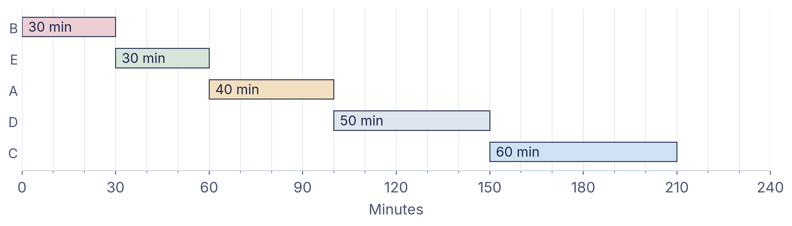

<span class="question">Question:</span> **Where can we see the waiting time?**

## Waiting time adds up to 340 minutes

<span class="highlight">Total waiting time:</span> 340 minutes

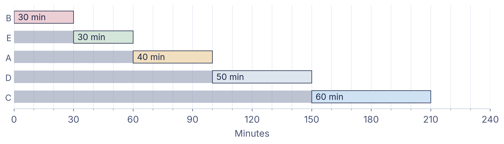

Grey: time a task waits before it starts.

<span class="question">Question:</span> **Would this be applicable for your work?**

## Goal 3: deliver the most value

- <span class="highlight">Change:</span> Tasks now have **different values**, e.g. revenue for a consultant

``` python
Task  Duration  Revenue
  A    20min    €240
  B    30min    €200
  C    60min    €120
  D    50min    €70
  E    30min    €130
  F    40min    €120
  G    20min    €100
  H    70min    €110
  I    50min    €90
```

<span class="question">Question:</span> **Any ideas how to approach this?**

## Weighted SPT: highest value per minute first

<span class="task">Rule:</span> Schedule by revenue per minute (descending)

``` python
Task  Duration  Revenue  Revenue/Min  Schedule
  A    20min    €240     12.0
  B    30min    €200      6.7
  C    60min    €120      2.0
  D    50min    €70       1.4
  E    30min    €130      4.3
  F    40min    €120      3.0
  G    20min    €100      5.0
  H    70min    €110      1.6
  I    50min    €90       1.8
```

<span class="question">Question:</span> **What's the order of scheduled tasks?**

## Weighted SPT: highest value per minute first

<span class="task">Rule:</span> Schedule by revenue per minute (descending)

``` python
Task  Duration  Revenue  Revenue/Min  Schedule
  A    20min    €240     12.0           1
  B    30min    €200      6.7
  C    60min    €120      2.0
  D    50min    €70       1.4
  E    30min    €130      4.3
  F    40min    €120      3.0
  G    20min    €100      5.0
  H    70min    €110      1.6
  I    50min    €90       1.8
```

## Weighted SPT: highest value per minute first

<span class="task">Rule:</span> Schedule by revenue per minute (descending)

``` python
Task  Duration  Revenue  Revenue/Min  Schedule
  A    20min    €240     12.0           1
  B    30min    €200      6.7           2
  C    60min    €120      2.0
  D    50min    €70       1.4
  E    30min    €130      4.3
  F    40min    €120      3.0
  G    20min    €100      5.0
  H    70min    €110      1.6
  I    50min    €90       1.8
```

## Weighted SPT: highest value per minute first

<span class="task">Rule:</span> Schedule by revenue per minute (descending)

``` python
Task  Duration  Revenue  Revenue/Min  Schedule
  A    20min    €240     12.0           1
  B    30min    €200      6.7           2
  C    60min    €120      2.0
  D    50min    €70       1.4
  E    30min    €130      4.3
  F    40min    €120      3.0
  G    20min    €100      5.0           3
  H    70min    €110      1.6
  I    50min    €90       1.8
```

## Weighted SPT: highest value per minute first

<span class="task">Rule:</span> Schedule by revenue per minute (descending)

``` python
Task  Duration  Revenue  Revenue/Min  Schedule
  A    20min    €240     12.0           1
  B    30min    €200      6.7           2
  C    60min    €120      2.0
  D    50min    €70       1.4
  E    30min    €130      4.3           4
  F    40min    €120      3.0
  G    20min    €100      5.0           3
  H    70min    €110      1.6
  I    50min    €90       1.8
```

## Weighted SPT: highest value per minute first

<span class="task">Rule:</span> Schedule by revenue per minute (descending)

``` python
Task  Duration  Revenue  Revenue/Min  Schedule
  A    20min    €240     12.0           1
  B    30min    €200      6.7           2
  C    60min    €120      2.0
  D    50min    €70       1.4
  E    30min    €130      4.3           4
  F    40min    €120      3.0           5
  G    20min    €100      5.0           3
  H    70min    €110      1.6
  I    50min    €90       1.8
```

## Weighted SPT: highest value per minute first

<span class="task">Rule:</span> Schedule by revenue per minute (descending)

``` python
Task  Duration  Revenue  Revenue/Min  Schedule
  A    20min    €240     12.0           1
  B    30min    €200      6.7           2
  C    60min    €120      2.0           6
  D    50min    €70       1.4
  E    30min    €130      4.3           4
  F    40min    €120      3.0           5
  G    20min    €100      5.0           3
  H    70min    €110      1.6
  I    50min    €90       1.8
```

## Weighted SPT: highest value per minute first

<span class="task">Rule:</span> Schedule by revenue per minute (descending)

``` python
Task  Duration  Revenue  Revenue/Min  Schedule
  A    20min    €240     12.0           1
  B    30min    €200      6.7           2
  C    60min    €120      2.0           6
  D    50min    €70       1.4
  E    30min    €130      4.3           4
  F    40min    €120      3.0           5
  G    20min    €100      5.0           3
  H    70min    €110      1.6
  I    50min    €90       1.8           7
```

## Weighted SPT: highest value per minute first

<span class="task">Rule:</span> Schedule by revenue per minute (descending)

``` python
Task  Duration  Revenue  Revenue/Min  Schedule
  A    20min    €240     12.0           1
  B    30min    €200      6.7           2
  C    60min    €120      2.0           6
  D    50min    €70       1.4
  E    30min    €130      4.3           4
  F    40min    €120      3.0           5
  G    20min    €100      5.0           3
  H    70min    €110      1.6           8
  I    50min    €90       1.8           7
```

## Weighted SPT: highest value per minute first

<span class="task">Rule:</span> Schedule by revenue per minute (descending)

``` python
Task  Duration  Revenue  Revenue/Min  Schedule
  A    20min    €240     12.0           1
  B    30min    €200      6.7           2
  C    60min    €120      2.0           6
  D    50min    €70       1.4           9
  E    30min    €130      4.3           4
  F    40min    €120      3.0           5
  G    20min    €100      5.0           3
  H    70min    €110      1.6           8
  I    50min    €90       1.8           7
```

> **Metric Priorities**
>
> Without revenues, we can use the same approach with **metric priorities**!

## Deadlines with dependencies

<span class="question">Question:</span> **What was earliest due date again?**

- Sort the tasks by deadline
- Now some tasks must **wait for a predecessor**

``` python
Task  Duration  Deadline  Predecessor
  A    40min    110min    None
  B    30min     90min    D
  C    60min    150min    A
  D    50min     70min    None
  E    30min    210min    C
```

<span class="question">Question:</span> **Any ideas how to solve this?**

## Lawler's algorithm: fill the schedule from the back

<span class="task">Rule:</span> We can use **Lawler's Algorithm** (1968)

1.  Consider all tasks <span class="highlight">without successors</span>
2.  Choose the one with **latest deadline**
3.  Schedule the task **last**
4.  **Remove** it from the network and start again

## Lawler's Applied

``` python
Task  Duration  Deadline  Predecessor Schedule
  A    40min    110min    None
  B    30min     90min    D
  C    60min    150min    A
  D    50min     70min    None
  E    30min    210min    C
```

<span class="question">Question:</span> **What's the schedule?**

## Lawler's Applied

``` python
Task  Duration  Deadline  Predecessor Schedule
  A    40min    110min    None
  B    30min     90min    D
  C    60min    150min    A
  D    50min     70min    None
  E    30min    210min    C             5
```

## Lawler's Applied

``` python
Task  Duration  Deadline  Predecessor Schedule
  A    40min    110min    None
  B    30min     90min    D
  C    60min    150min    A             4
  D    50min     70min    None
  E    30min    210min    C             5
```

## Lawler's Applied

``` python
Task  Duration  Deadline  Predecessor Schedule
  A    40min    110min    None          3
  B    30min     90min    D
  C    60min    150min    A             4
  D    50min     70min    None
  E    30min    210min    C             5
```

## Lawler's Applied

``` python
Task  Duration  Deadline  Predecessor Schedule
  A    40min    110min    None          3
  B    30min     90min    D             2
  C    60min    150min    A             4
  D    50min     70min    None
  E    30min    210min    C             5
```

## Lawler's Applied

``` python
Task  Duration  Deadline  Predecessor Schedule
  A    40min    110min    None          3
  B    30min     90min    D             2
  C    60min    150min    A             4
  D    50min     70min    None          1
  E    30min    210min    C             5
```

> **Successor Tasks**
>
> Note, how all tasks become tasks without successors at some point.

## The Lawler schedule

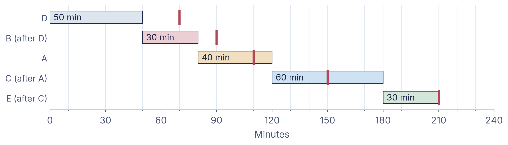

The task in brackets must be finished first. Red marks: deadlines.

<span class="question">Question:</span> **What's the maximum delay?**

## Waiting time with dependencies has no fast exact solution

- <span class="highlight">NP-hard</span>: no known algorithm solves it efficiently
- True for **most scheduling problems**
- In practice we use **heuristics**, good rules without a guarantee

## Your goal decides the rule: deadlines, waiting time, value

<span class="eyebrow">What we covered</span>

<span class="statement">Each goal has its own simple rule: earliest deadline first to avoid being late, shortest task first to cut waiting, highest value per minute first to maximize what you deliver.</span>

# <span class="flow">Real life: dependencies, interruptions and thrashing</span>

## Roadmap

1.  <span class="roadmap-item done">The basics: when order matters, and when it doesn't</span>
2.  <span class="roadmap-item done">Your goal decides the rule: deadlines, waiting time, value</span>
3.  <span class="roadmap-item current">Real life: dependencies, interruptions and thrashing</span>

## Priority inversion: an important task waits for an unimportant one

**Setup** (priority 1 = highest):

``` python
Task  Duration  Priority
  A    20min     3
  B    30min     1
  C    30min     2
  D    30min     2
  E    30min     2
```

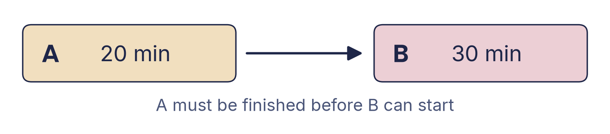

<span class="fragment">**Challenge:**
High-priority tasks depend on low-priority tasks.</span>

<span class="fragment"><span class="highlight">Risk:</span> Priority inversion can lead to significant delays!</span>

<span class="fragment center"></span>

## Priority inheritance: the blocker borrows the priority

<span class="question">Question:</span> **How do we prevent the inversion?**

- <span class="task">Rule:</span> Tasks inherit priority from their dependents.
- A inherits priority 1 from B and is done first
- B can start right after A, C to E follow

``` python
Task  Duration  Priority
  A    20min     1
  B    30min     1
  C    30min     2
  D    30min     2
  E    30min     2
```

## Interruptions: new tasks arrive while you work

- In reality we **cannot predict the future**
- New tasks arrive **while we work**
- Let's look at this for the <span class="highlight">earliest due date objective</span>

## A morning with seven tasks

8:00-12:00 Schedule, tasks arrive during the morning:

``` python
Task           Arrives  Duration  Deadline
Email A         8:00    20min      9:00
Create PPT      8:00    60min     10:50
Investor call   8:30    10min      9:00
Email B         8:40    30min     10:20
Liquidity       9:00    40min     11:00
Email C         9:00    20min     11:20
Email D         9:20    40min     10:00
```

<span class="question">Question:</span> **How would you start, if the goal is to avoid being late?**

## EDD in real time: switch only for an earlier deadline

<span class="task">Rule:</span>

- Always work on the task with the **earliest deadline**
- A new task with an **earlier** deadline interrupts the current one
- Otherwise, stick to the current task

## The real-time EDD schedule

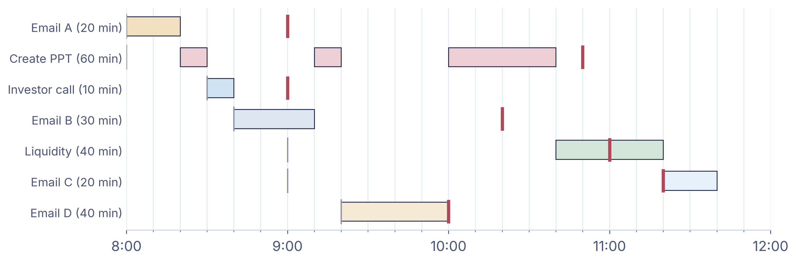

Grey line: arrival, red mark: deadline.

<span class="question">Question:</span> **What's the maximum delay with this schedule?**

## Same morning, new goal: as little waiting as possible

<span class="question">Question:</span> **How would you start here?**

## SPT in real time: switch only for a shorter task

<span class="task">Rule:</span>

- Always work on the task with the **shortest duration**
- A new task that is **shorter** interrupts the current one
- Otherwise, stick to the current task

## The real-time SPT schedule

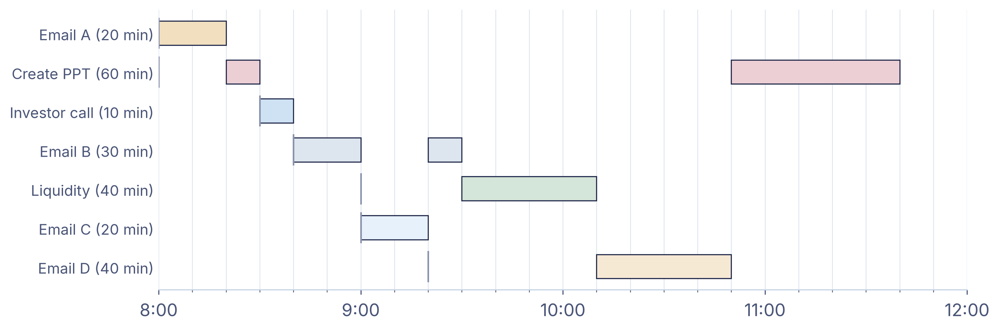

<span class="question">Question:</span> **Where can we see the waiting time?**

## The real-time SPT schedule

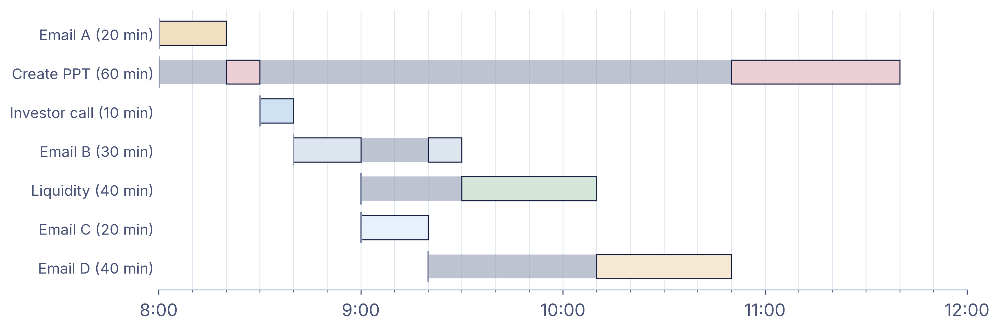

<span class="highlight">Total waiting time:</span> 260 minutes

## Thrashing: switching so much that nothing gets done

- Excessive **context switching**
- Organization <span class="highlight">overhead exceeds productivity</span>
- Maximum activity, minimum output

<span class="question">Question:</span> **Have you ever experienced this?**

## Warning signs of thrashing

- Constant **task switching**
- **Nothing** getting completed
- Increasing **stress levels**
- Declining **quality**

<span class="question">Question:</span> **Any ideas how to prevent this?**

## Preventing thrashing: long-term rules

1.  Task rejection/delegation threshold
2.  Simplified organization systems
3.  Minimum work period rules
4.  Reduced reactivity requirements

## Preventing thrashing: today's tactics

1.  Time blocking
2.  Focus periods
3.  Task batching
4.  Priority freezes

<span class="question">Question:</span> **What strategies have worked for you?**

## How to use this starting today

- **Daily planning:** SPT for your to-do list, less waiting
- **Project management:** EDD when deadlines matter
- **Team coordination:** Johnson's rule for two-stage processes
- **Time blocking:** prevent thrashing

## Real life: dependencies, interruptions and thrashing

<span class="eyebrow">What we covered</span>

<span class="statement">Dependencies make planning harder, and constant switching eats up your time. Protect blocks of focused work.</span>

## What we covered

<span class="eyebrow">The basics: when order matters, and when it doesn't</span>

Sometimes the order of tasks changes the result, sometimes it doesn't. Knowing which saves time.

<span class="eyebrow">Your goal decides the rule: deadlines, waiting time, value</span>

Each goal has its own simple rule: earliest deadline first to avoid being late, shortest task first to cut waiting, highest value per minute first to maximize what you deliver.

<span class="eyebrow">Real life: dependencies, interruptions and thrashing</span>

Dependencies make planning harder, and constant switching eats up your time. Protect blocks of focused work.

## Why it matters

Monday morning, ten tasks on your list: where do you start? Companies face the same question at scale: which order on the production line, which customer order first, which project gets the team this week.

## 

First choose your goal.

Then choose your order.

## 

Any questions

so far?

## After the break: Scheduling

- Programming session in our new notebooks
- Today's rules in code: dictionaries and DataFrames
- Different scheduling algorithms applied to problems

# <span class="flow">Literature</span>

## Interesting literature to start

- Christian, B., & Griffiths, T. (2016). Algorithms to live by: the computer science of human decisions. First international edition. New York, Henry Holt and Company.[^1]

## Books on Programming

- Downey, A. B. (2024). Think Python: How to think like a computer scientist (Third edition). O'Reilly. [Free online](https://greenteapress.com/wp/think-python-3rd-edition/)
- Elter, S. (2021). Schrödinger programmiert Python: Das etwas andere Fachbuch (1. Auflage). Rheinwerk Verlag.

> **Note**
>
> Think Python is free online and a great start. Schrödinger programmiert Python is a playful alternative in German.

## More Literature

For more interesting literature, take a look at the [literature list](../general/literature.qmd) of this course.

[^1]: The main inspiration for this lecture. We have read it and discussed it in depth, always wanting to translate it into a course.
