## Today in one sentence

<span class="statement">There is no single best order for your tasks: first decide what you want to achieve, and the right rule follows.</span>

<span class="eyebrow">Why it matters</span>

Monday morning, ten tasks on your list: where do you start? Companies face the same question at scale: which order on the production line, which customer order first, which project gets the team this week.

## Roadmap

1.  <span class="roadmap-item future">The basics: when order matters, and when it doesn't</span>
2.  <span class="roadmap-item future">Your goal decides the rule: deadlines, waiting time, value</span>
3.  <span class="roadmap-item future">Real life: dependencies, interruptions and thrashing</span>

# <span class="flow">The basics: when order matters, and when it doesn't</span>

## Ten tasks, one day: where do you start?

<span class="question">Question:</span> **How do you decide?**

- With the most urgent one
- With the quickest one
- With the most important one

Keep your answer in mind. We come back to it.

## Four loads of laundry, one washer, one dryer

Every load is washed first, then dried.

Each machine handles one load at a time.

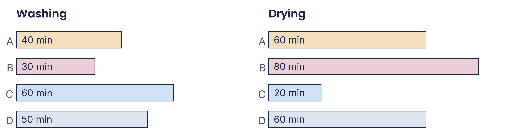

## Goal: all laundry done as early as possible

``` python
Load  Washing  Drying
  A    40min   60min
  B    30min   80min
  C    60min   20min
  D    50min   60min
```

<span class="highlight">Goal:</span> **Finish all four loads as early as possible**

<span class="question">Question:</span> **In which order would you wash?**

## Johnson's rule

<span class="task">Rule:</span>[^1]

1.  Find the **shortest time** in the whole table
2.  Is it a **wash**? Put that load as **early** as possible
3.  Is it a **dry**? Put that load as **late** as possible
4.  Cross out the load and **repeat**

In words: short washes go first, so the dryer can start early. Short dries go last, so little is left to do once the washer has finished.

## Applying Johnson's rule

``` python
Load  Washing  Drying  Schedule
  A    40min   60min
  B    30min   80min
  C    60min   20min
  D    50min   60min
```

<span class="question">Question:</span> **Which load do we place first, and where?**

## Applying Johnson's rule

``` python
Load  Washing  Drying  Schedule
  A    40min   60min
  B    30min   80min
  C    60min   20min        4
  D    50min   60min
```

- The shortest time is C's dry, 20 minutes
- It is a dry, so C goes last

<span class="question">Question:</span> **Which load is next?**

## Applying Johnson's rule

``` python
Load  Washing  Drying  Schedule
  A    40min   60min
  B    30min   80min        1
  C    60min   20min        4
  D    50min   60min
```

- The shortest time is B's wash, 30 minutes
- It is a wash, so B goes first

<span class="question">Question:</span> **Which load is next?**

## Applying Johnson's rule

``` python
Load  Washing  Drying  Schedule
  A    40min   60min        2
  B    30min   80min        1
  C    60min   20min        4
  D    50min   60min
```

- The shortest time is A's wash, 40 minutes
- It is a wash, so A goes second

<span class="highlight">Now, we only have one load left!</span>

## Applying Johnson's rule

``` python
Load  Washing  Drying  Schedule
  A    40min   60min        2
  B    30min   80min        1
  C    60min   20min        4
  D    50min   60min        3
```

**Final sequence: <span class="highlight">B A D C</span>**

## The best order takes 4 hours 10 minutes

**Best order: <span class="highlight">B A D C</span>**

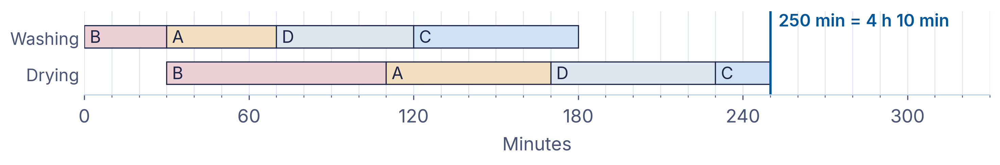

## How to read this chart

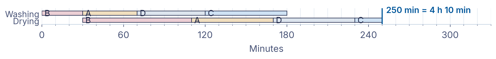

- One row per machine
- One bar per load
- Time runs from left to right
- It is called a **Gantt chart**, after Henry Gantt, who drew such charts around 1910 for factory planning.

<span class="question">Question:</span> **How much worse can it get?**

## A bad order takes one hour longer

**A bad order: <span class="highlight">C D A B</span>**

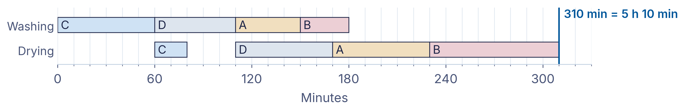

<span class="question">Question:</span> **Why is this order worse?**

The dryer waits a full hour for the first wash, and the longest dry comes at the very end.

## Johnson's rule beyond laundry

- Any work in two steps, where the second step waits for the first
- **You:** when cooking, start with what is quick to prepare and long in the oven
- **Companies:** a report goes from the analyst to the reviewer. Start with the report that is quick to write and long to review

Order the work so that the second step never stands idle.

## Scheduling is everywhere

<span class="question">Question:</span> **Where do companies schedule?**

- **Projects:** which task first, who works on what
- **Production:** which order on the line
- **Hospitals:** patients, surgeries, staff
- **Transport:** routes, crews, maintenance
- **Software:** which program gets the processor

## What do we know about a task?

- **Duration:** how long does it take?
- **Deadline:** when is it due?
- **Value:** how much is it worth?
- **Dependency:** what must be done before?

Which of these we look at depends on our goal.

## One person instead of two machines

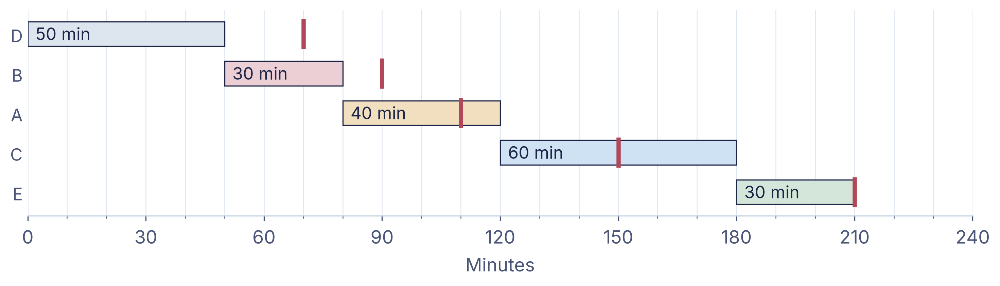

<span class="question">Question:</span> **What is different from before?**

## One person: does the order matter?

<span class="question">Question:</span> **Does the order change how long we need?**

> **Note**
>
> With one person and no deadlines, every order takes the same **total time**.

<span class="question">Question:</span> **So the order is irrelevant?**

> **Important**
>
> No. Order becomes crucial with **deadlines, priorities and dependencies**.

Reordering your to-do list does not make it shorter. Order only matters once you say what you want.

# <span class="flow">Your goal decides the rule: deadlines, waiting time, value</span>

## Roadmap

1.  <span class="roadmap-item done">The basics: when order matters, and when it doesn't</span>
2.  <span class="roadmap-item current">Your goal decides the rule: deadlines, waiting time, value</span>
3.  <span class="roadmap-item future">Real life: dependencies, interruptions and thrashing</span>

## What do you want?

1.  Not be late
2.  Wait as little as possible
3.  Deliver the most value

Each goal has its own rule.

Companies know this conflict: sales wants every order on time, production wants as much output as possible.

## Goal 1: don't be too late

Tasks with individual deadlines:

``` python
Task  Duration  Deadline
  A    40min    110min
  B    30min     90min
  C    60min    150min
  D    50min     70min
  E    30min    210min
```

All times count from now: task D is due in 70 minutes.

<span class="highlight">Goal:</span> **Keep the worst delay as small as possible**

<span class="question">Question:</span> **In which order would you work?**

## Earliest deadline first

<span class="task">Rule:</span> Sort the tasks by deadline, earliest first.

This rule is called **Earliest Due Date**, or EDD.

``` python
Task  Duration  Deadline
  A    40min    110min
  B    30min     90min
  C    60min    150min
  D    50min     70min
  E    30min    210min
```

``` python
Task  Duration  Deadline
  D    50min     70min
  B    30min     90min
  A    40min    110min
  C    60min    150min
  E    30min    210min
```

<span class="highlight">Let's visualize this!</span>

## The plan: earliest deadline first

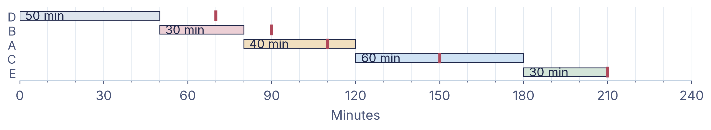

Red marks: deadlines.

<span class="question">Question:</span> **What is the worst delay here?**

30 minutes, for task C. Task A is 10 minutes late.

In the order A to E, task D would be 110 minutes late.

## Earliest due date in real life

- **You:** work on assignments in the order they are due
- **Companies:** produce customer orders in the order of the promised delivery date
- **Watch out:** the rule ignores how long a task takes and how important it is

## Goal 2: as little waiting as possible

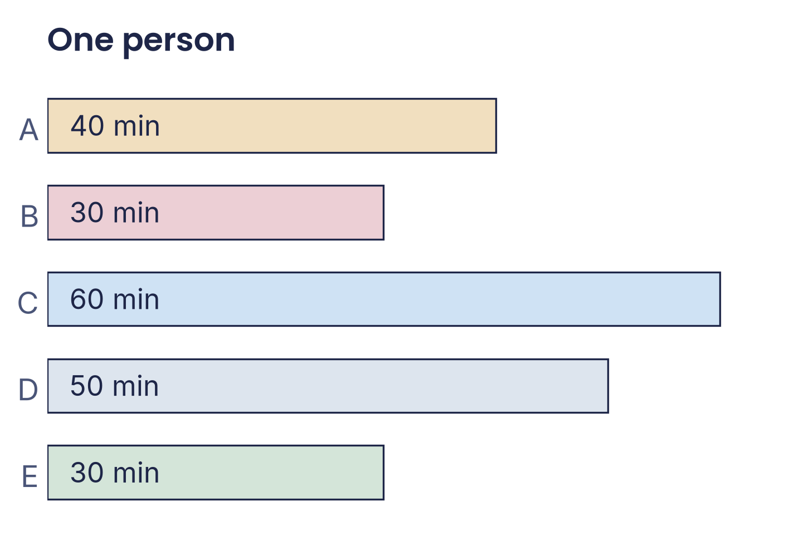

No deadlines this time. For each task, someone is waiting.

<span class="fragment"><span class="highlight">Goal:</span> Keep the total waiting time as small as possible</span>

<span class="fragment"><span class="question">Question:</span> **Which task first?**</span>

## Shortest task first

<span class="task">Rule:</span> Always do the **shortest remaining task** next. If two are equally short, pick either.

This rule is called **Shortest Processing Time**, or SPT.

``` python
Task  Duration  Schedule
  A    40min
  B    30min
  C    60min
  D    50min
  E    30min
```

<span class="question">Question:</span> **In which order do we work?**

## Shortest task first

<span class="task">Rule:</span> Always do the **shortest remaining task** next. If two are equally short, pick either.

This rule is called **Shortest Processing Time**, or SPT.

``` python
Task  Duration  Schedule
  A    40min        3
  B    30min        1
  C    60min        5
  D    50min        4
  E    30min        2
```

**Final sequence: <span class="highlight">B E A D C</span> or <span class="highlight">E B A D C</span>**

## The plan: shortest task first

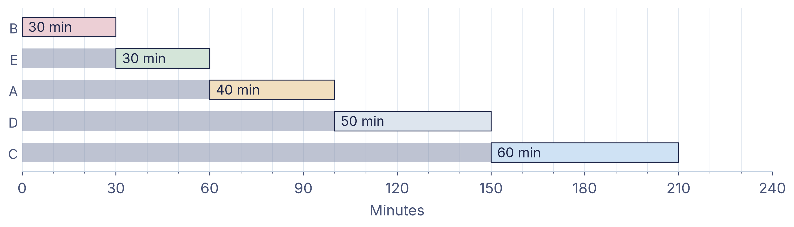

<span class="question">Question:</span> **Where can we see the waiting time?**

## Waiting time adds up to 340 minutes

<span class="highlight">Total waiting time:</span> 340 minutes

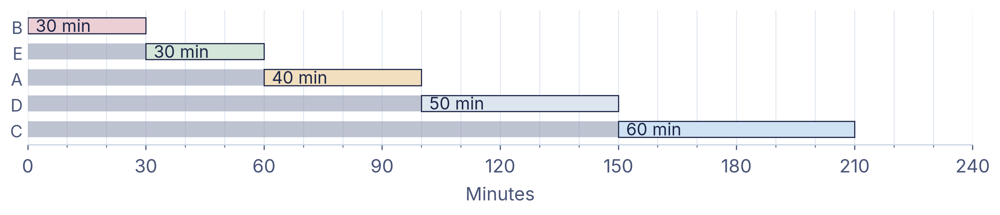

Grey: time a task waits before it starts.

The other way round, longest task first: 500 minutes.

## Shortest task first in real life

- **You:** if it takes less than two minutes, do it now
- **Companies:** a help desk that answers quick requests first makes the average customer wait less
- **Why it works:** a short task makes everyone behind it wait only a little
- **Watch out:** the big task keeps getting pushed back

## Goal 3: deliver the most value

- <span class="highlight">Change:</span> Tasks now have **different values**, e.g. revenue for a consultant

``` python
Task  Duration  Revenue
  A    20min    €240
  B    30min    €200
  C    60min    €120
  D    50min    €70
  E    30min    €130
  F    40min    €120
  G    20min    €100
  H    70min    €110
  I    50min    €90
```

<span class="question">Question:</span> **Which task first?**

## Highest value per minute first

<span class="task">Rule:</span> Highest revenue per minute first

``` python
Task  Duration  Revenue  Revenue/Min  Schedule
  A    20min    €240     12.0
  B    30min    €200      6.7
  C    60min    €120      2.0
  D    50min    €70       1.4
  E    30min    €130      4.3
  F    40min    €120      3.0
  G    20min    €100      5.0
  H    70min    €110      1.6
  I    50min    €90       1.8
```

Revenue per minute = revenue divided by duration. Task A: 240 euros / 20 minutes = 12 euros per minute.

<span class="question">Question:</span> **In which order do we work?**

## Highest value per minute first

<span class="task">Rule:</span> Highest revenue per minute first

``` python
Task  Duration  Revenue  Revenue/Min  Schedule
  A    20min    €240     12.0           1
  B    30min    €200      6.7           2
  C    60min    €120      2.0
  D    50min    €70       1.4
  E    30min    €130      4.3
  F    40min    €120      3.0
  G    20min    €100      5.0           3
  H    70min    €110      1.6
  I    50min    €90       1.8
```

## Highest value per minute first

<span class="task">Rule:</span> Highest revenue per minute first

``` python
Task  Duration  Revenue  Revenue/Min  Schedule
  A    20min    €240     12.0           1
  B    30min    €200      6.7           2
  C    60min    €120      2.0           6
  D    50min    €70       1.4           9
  E    30min    €130      4.3           4
  F    40min    €120      3.0           5
  G    20min    €100      5.0           3
  H    70min    €110      1.6           8
  I    50min    €90       1.8           7
```

## Value per minute in real life

- **You:** before an exam, study first what brings the most points per hour
- **Companies:** when machine time is scarce, produce the order that earns the most per machine hour

You may know this from cost accounting: contribution margin per unit of the bottleneck.

No money involved? Rate the importance from 1 to 10 instead.

# <span class="flow">Real life: dependencies, interruptions and thrashing</span>

## Roadmap

1.  <span class="roadmap-item done">The basics: when order matters, and when it doesn't</span>
2.  <span class="roadmap-item done">Your goal decides the rule: deadlines, waiting time, value</span>
3.  <span class="roadmap-item current">Real life: dependencies, interruptions and thrashing</span>

## A spacecraft that kept restarting

- In July 1997, NASA's Pathfinder landed on Mars
- Then its computer started to restart again and again
- The cause: an important task was waiting for an unimportant one[^2]

<span class="question">Question:</span> **How can that happen?**

## Priority inversion: an important task waits for an unimportant one

**Setup** (priority 1 = highest):

``` python
Task  Duration  Priority
  A    20min     3
  B    30min     1
  C    30min     2
  D    30min     2
  E    30min     2
```

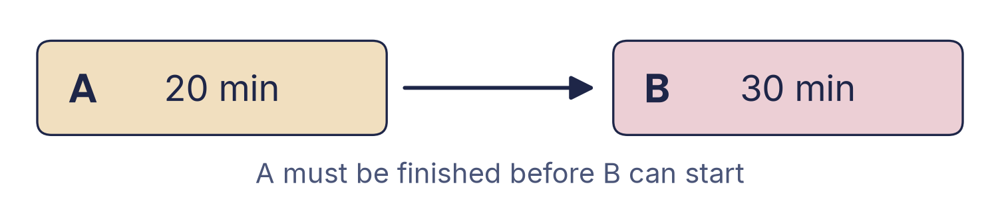

- B is the most important task, but it needs A first
- A has the lowest priority, so C, D and E go first
- B waits 110 minutes for its turn

<span class="fragment center"></span>

## How do we prevent this?

<span class="question">Question:</span> **What should happen with task A?**

<span class="task">Rule:</span> A task takes over the priority of the task that waits for it

``` python
Task  Duration  Priority
  A    20min     1
  B    30min     1
  C    30min     2
  D    30min     2
  E    30min     2
```

B now starts after 20 minutes instead of 110

This is called **priority inheritance**. It is how NASA fixed Pathfinder, from Earth.

## Priority inheritance in real life

- **You:** shopping has the priority of the dinner it is for
- **Companies:** a 5 euro spare part that stops a machine has the priority of the machine

A task is as important as what waits for it.

## With dependencies, there is often no quick recipe

- For deadlines, waiting time and value, sorting is enough
- Add dependencies, and for many goals nobody knows a fast way to find the best plan
- In practice: good rules of thumb, or software that searches for a good plan

A good plan now beats a perfect plan too late.

## Interruptions: new tasks arrive while you work

- In reality we **cannot predict the future**
- New tasks arrive **while we work**
- We look at it with our first goal: <span class="highlight">don't be too late</span>

## A morning with seven tasks

It is 8:00. These tasks arrive during the morning:

``` python
Task              Arrives  Duration  Deadline
Email A            8:00    20min      9:00
Presentation       8:00    60min     10:50
Investor call      8:30    10min      9:00
Email B            8:40    30min     10:20
Liquidity report   9:00    40min     11:00
Email C            9:00    20min     11:20
Email D            9:20    40min     10:00
```

<span class="question">Question:</span> **How would you start, if the goal is to avoid being late?**

## In real time: switch only for an earlier deadline

<span class="task">Rule:</span>

- Always work on the task with the **earliest deadline**
- A new task with an **earlier** deadline interrupts the current one
- Otherwise, stick to the current task

This works for any goal: switch only if the new task beats the current one.

## The morning, planned in real time

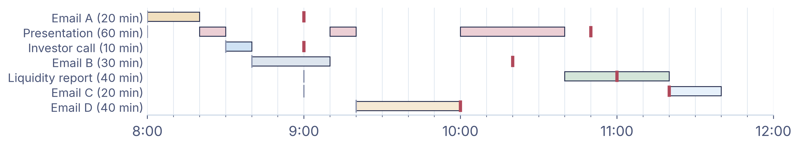

Grey line: arrival, red mark: deadline.

<span class="question">Question:</span> **What is the worst delay with this plan?**

20 minutes, for the liquidity report and Email C.

No plan does better here: there is simply more work than time.

## Every switch costs

- Every time you switch tasks, you clear your desk for three books and set it up again
- The switch itself produces nothing
- Switch often enough, and switching is all you do

## Thrashing: switching so much that nothing gets done

- You switch tasks all the time
- Nothing gets finished
- Stress goes up, quality goes down

<span class="question">Question:</span> **Have you ever experienced this?**

## Bundle your interruptions

- **You:** check email and messages at set times, not as they arrive
- **Companies:** one weekly approval round instead of requests at any time
- **How fast must you respond?** It is rarely "immediately"
- **Too much on the list?** Say no or hand over

## Which rule when?

| Situation | Rule |
|------------------------------------|------------------------------------|
| Work in two steps | Johnson: quick first step early, quick second step late |
| Deadlines count | Earliest due date first |
| People are waiting | Shortest task first |
| Tasks differ in value | Highest value per minute first |
| One task blocks another | The blocker gets the priority of what waits for it |
| New tasks keep arriving | Switch only for a better task, bundle the rest |

Urgent, quick or important? It depends on your goal.

## What we covered

<span class="eyebrow">The basics: when order matters, and when it doesn't</span>

Sometimes the order of tasks changes the result, sometimes it doesn't. Knowing which saves time.

<span class="eyebrow">Your goal decides the rule: deadlines, waiting time, value</span>

Each goal has its own simple rule: earliest deadline first to avoid being late, shortest task first to cut waiting, highest value per minute first to maximize what you deliver.

<span class="eyebrow">Real life: dependencies, interruptions and thrashing</span>

Dependencies make planning harder, and constant switching eats up your time. Protect blocks of focused work.

## Why it matters

Monday morning, ten tasks on your list: where do you start? Companies face the same question at scale: which order on the production line, which customer order first, which project gets the team this week.

## 

First choose your goal.

Then choose your order.

## 

Any questions

so far?

## After the break: dictionaries and DataFrames

- Programming session in our new notebooks
- Today's rules in code: dictionaries and DataFrames
- Different scheduling algorithms applied to problems

# <span class="flow">Literature</span>

## Interesting literature to start

- Christian, B., & Griffiths, T. (2016). Algorithms to live by: the computer science of human decisions. First international edition. New York, Henry Holt and Company.[^3]

## Books on Programming

- Downey, A. B. (2024). Think Python: How to think like a computer scientist (Third edition). O'Reilly. [Free online](https://greenteapress.com/wp/think-python-3rd-edition/)
- Elter, S. (2021). Schrödinger programmiert Python: Das etwas andere Fachbuch (1. Auflage). Rheinwerk Verlag.

> **Note**
>
> Think Python is free online and a great start. Schrödinger programmiert Python is a playful alternative in German.

## More Literature

For more interesting literature, take a look at the [literature list](../general/literature.qmd) of this course.

[^1]: Johnson, S. M. (1954). Optimal two- and three-stage production schedules with setup times included. Naval Research Logistics Quarterly, 1(1). Johnson proved that this rule gives the best possible order.

[^2]: Christian & Griffiths (2016), ch. 5.

[^3]: The main inspiration for this lecture. We have read it and discussed it in depth, always wanting to translate it into a course.
