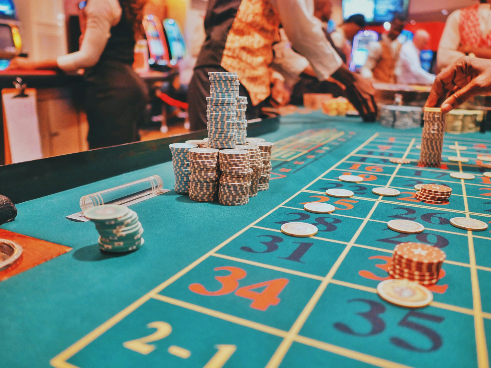
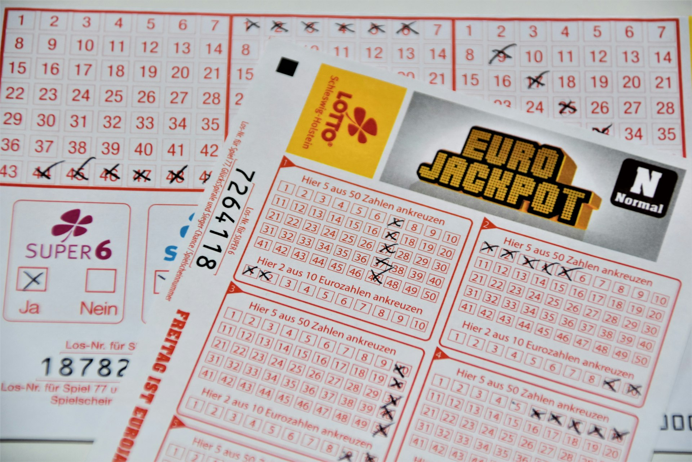
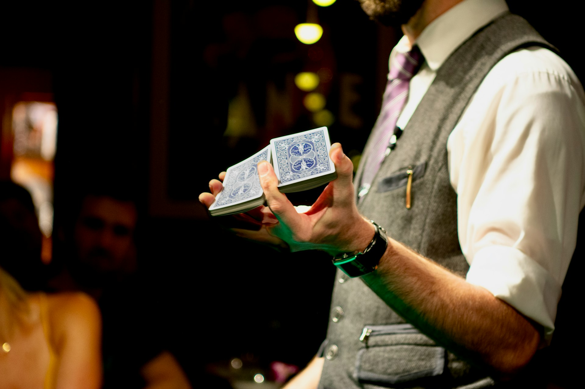
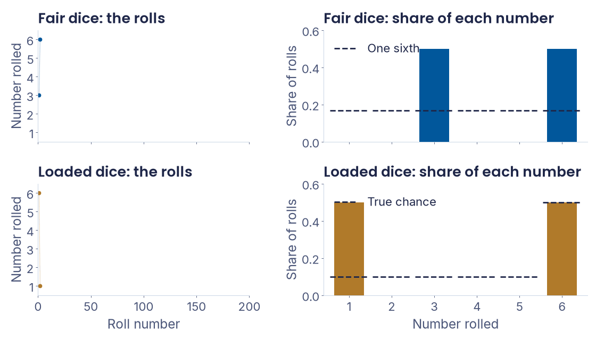
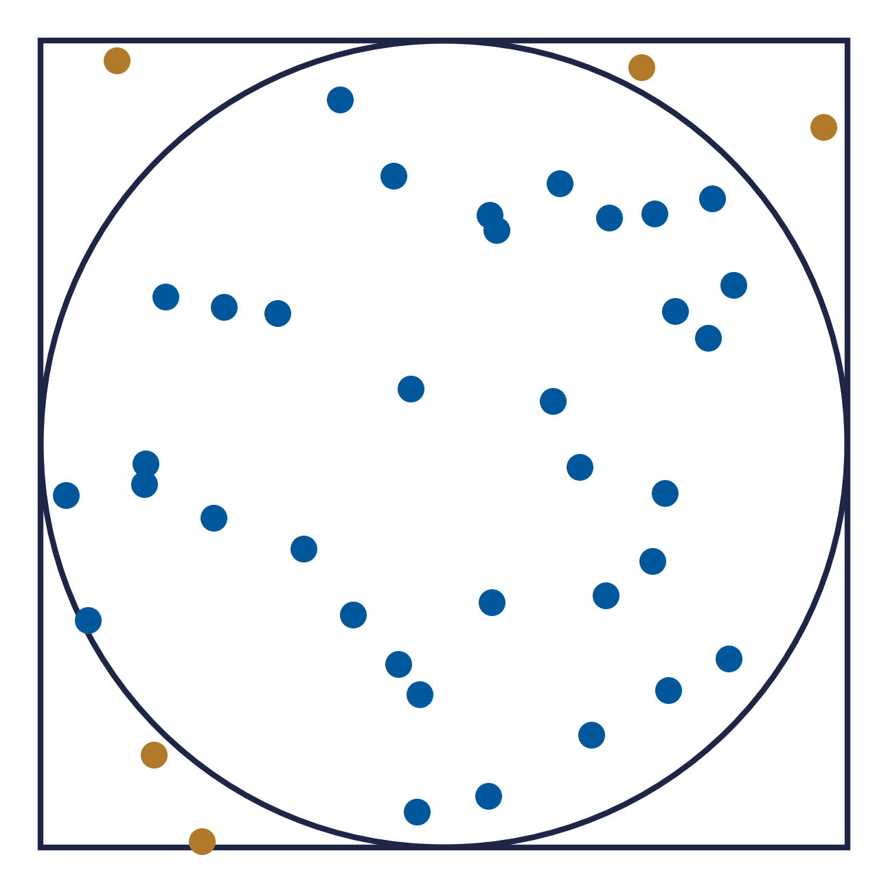
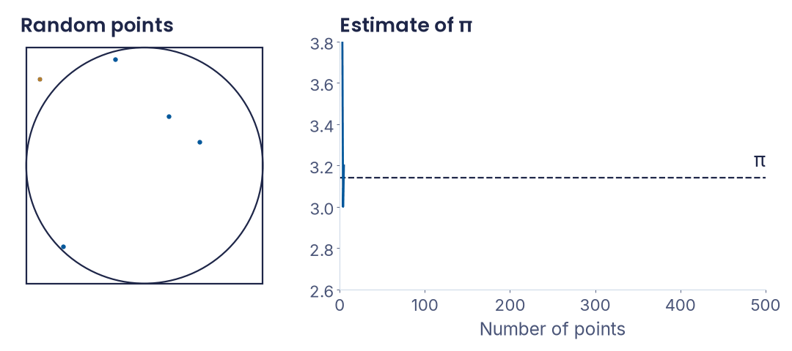
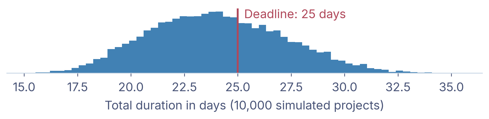
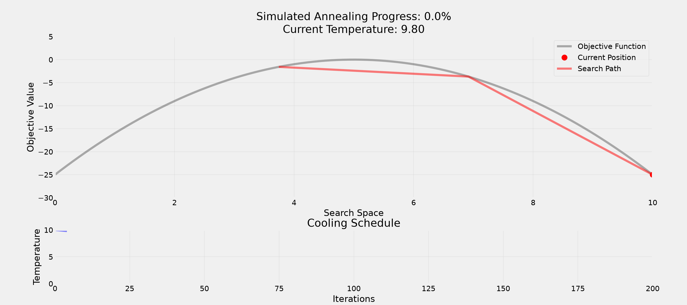
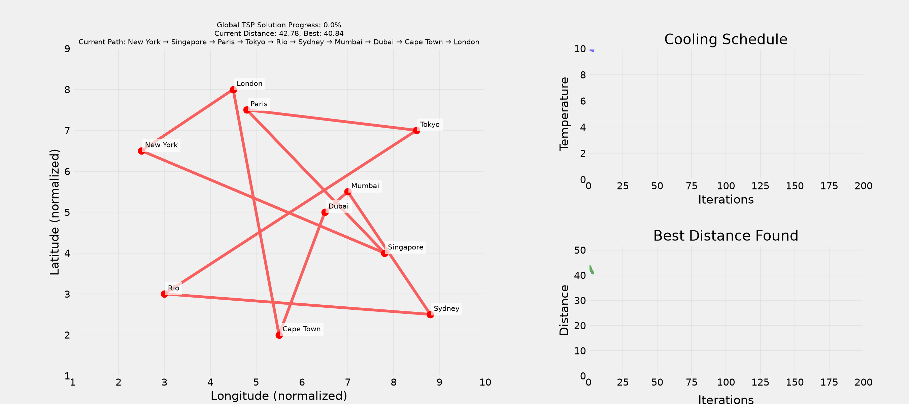
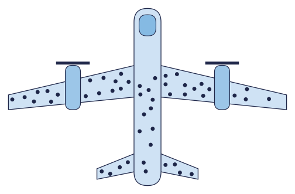

## Today in one sentence

<span class="statement">When a problem is too big to solve exactly, a bit of randomness often gets you a good answer fast.</span>

<span class="eyebrow">Why it matters</span>

Will your project finish on time? In which order should a driver visit 20 customers so that the tour is as short as possible? Questions like these are too complex to calculate exactly. Companies use randomness every day to estimate risks, plan delivery tours, survey customers and learn from a few what is true for the many.

## Roadmap

1.  <span class="roadmap-item future">Randomness is a tool</span>
2.  <span class="roadmap-item future">Simulate instead of calculate: Monte Carlo</span>
3.  <span class="roadmap-item future">Search smarter with chance</span>
4.  <span class="roadmap-item future">Sample instead of guess</span>

# <span class="flow">Randomness is a tool</span>

## What comes to your mind?

<span class="question">Question:</span> **What comes to your mind when you think of randomness?**

## Where does randomness show up?

<table style="width:100%;">
<colgroup>
<col style="width: 33%" />
<col style="width: 33%" />
<col style="width: 33%" />
</colgroup>
<tbody>
<tr>
<td style="text-align: left;"><div width="33.3%" data-layout-align="left">
<figure>

<figcaption aria-hidden="true">Casino</figcaption>
</figure>
</div></td>
<td style="text-align: left;"><div width="33.3%" data-layout-align="left">
<figure>

<figcaption aria-hidden="true">Lottery</figcaption>
</figure>
</div></td>
<td style="text-align: left;"><div width="33.3%" data-layout-align="left">
<figure>

<figcaption aria-hidden="true">Shuffling cards</figcaption>
</figure>
</div></td>
</tr>
</tbody>
</table>

<table style="width:100%;">
<colgroup>
<col style="width: 33%" />
<col style="width: 33%" />
<col style="width: 33%" />
</colgroup>
<tbody>
<tr>
<td style="text-align: left;"><div width="33.3%" data-layout-align="left">
<figure>

<figcaption aria-hidden="true">Algorithms</figcaption>
</figure>
</div></td>
<td style="text-align: left;"><div width="33.3%" data-layout-align="left">
<figure>

<figcaption aria-hidden="true">Cryptography</figcaption>
</figure>
</div></td>
<td style="text-align: left;"><div width="33.3%" data-layout-align="left">
<figure>

<figcaption aria-hidden="true">Genetic mutations</figcaption>
</figure>
</div></td>
</tr>
</tbody>
</table>

## What is the opposite of randomness?

<span class="question">Question:</span> **What's the opposite of randomness?**

- **Determinism:** same input, same output
- **Predictability:** knowing the outcome in advance
- **Consistency:** reliable patterns

- <span class="highlight">Boredom?</span>

## Are these dice fair?

<span class="question">Question:</span> **How would you test if dice are fair?**

- Send them to a lab to check weight and balance
- Or simply: roll them **many times**
- Count how often each number comes up
- Fair dice show each number about **one sixth** of the time

## Fair and loaded dice after 200 rolls



## Where do you meet randomness every day?

<span class="question">Question:</span> **Where do you encounter randomness in daily life?**

- **A/B tests:** visitors are assigned to versions at random
- **Two-factor codes:** random numbers protect your login
- **Surveys:** a random sample gives an unbiased picture
- **Spotify shuffle:** made deliberately *less* random, because true randomness felt wrong to users[^1]
- **Tax audits:** random checks keep everyone honest
- **Lotteries:** some universities allocate study places by lottery

## Randomness is a tool, not just a gamble

- **Fairness:** nobody can influence the outcome
- **Security:** attackers cannot guess what comes next
- **Estimating:** try many random cases instead of calculating every one
- **Searching:** random steps lead out of dead ends

Estimating and searching are our topics today.

## Can a computer roll dice?

<span class="question">Question:</span> **How can a machine that only calculates produce randomness?**

<span class="highlight">True randomness</span>

- comes from physics
- for example radioactive decay or atmospheric noise
- cannot be repeated

<span class="highlight">Pseudo-randomness</span>

- comes from a calculation
- looks random, but follows a rule
- can be repeated exactly

Computers do not roll dice, they calculate. The starting value is called the **seed**. Same seed, same numbers: that is why your tutorial results are reproducible.

# <span class="flow">Simulate instead of calculate: Monte Carlo</span>

## Roadmap

1.  <span class="roadmap-item done">Randomness is a tool</span>
2.  <span class="roadmap-item current">Simulate instead of calculate: Monte Carlo</span>
3.  <span class="roadmap-item future">Search smarter with chance</span>
4.  <span class="roadmap-item future">Sample instead of guess</span>

## Some things are too big to count

<span class="question">Question:</span> **How many possible orders exist for a shuffled deck of cards?**

``` python
import math
print(math.factorial(52))
```

    80658175170943878571660636856403766975289505440883277824000000000000

That is more than the number of atoms on Earth.[^2]

> **Important**
>
> No computer can ever go through all of these orders one by one.

<span class="question">Question:</span> **So how do we answer questions about card games?**

## A card game in 1946

<span class="question">Question:</span> **Anybody ever heard of Monte Carlo methods?**

- In 1946, the mathematician Stanislaw Ulam was recovering from an illness and played solitaire
- He wondered: what is the chance of winning?
- Calculating it was hopeless. So he thought: just play many games and count the wins
- The idea became the **Monte Carlo method**, named after the casino in Monaco[^3]

## How could we estimate π?



- Throw random points into the square
- Count how many land inside the circle
- The more points we throw, the closer we get to π

The idea goes back to Buffon, who in 1777 dropped needles on lined paper.[^4]

## Let's throw points



## Monte Carlo in business: a range instead of a single forecast

- **Project planning:** how likely do we finish before the deadline?
- **Finance:** how much could a portfolio lose in a bad month?
- **Inventory:** how much stock covers an uncertain demand?

The recipe: describe each uncertain input as a range, draw random values, repeat thousands of times, count.

## Will we finish in 25 days?

Three uncertain tasks, most likely **21 days** in total, deadline **25 days**:



- Only **63 %** of the simulated projects finish by day 25
- Only **18 %** finish within the most likely 21 days
- On average, the project takes **24 days**

## Monte Carlo in real life

- **You:** plan with a buffer. The most likely duration is too optimistic
- **Companies:** plan projects and budgets as a range with probabilities, not as a single number

When you can't calculate it, simulate it.

# <span class="flow">Search smarter with chance</span>

## Roadmap

1.  <span class="roadmap-item done">Randomness is a tool</span>
2.  <span class="roadmap-item done">Simulate instead of calculate: Monte Carlo</span>
3.  <span class="roadmap-item current">Search smarter with chance</span>
4.  <span class="roadmap-item future">Sample instead of guess</span>

## Remember Lecture IV?

- With dependencies, there is often no quick recipe for the best plan
- We said: companies use software that **searches** for a good plan
- Today: how such a search works, and why chance helps

## Ten cities, one trip: which order is shortest?

<span class="question">Question:</span> **In which order would you visit 10 cities by plane with minimal total distance?**

``` python
import math
print(math.factorial(10))
```

    3628800

<span class="question">Question:</span> **What could be a strategy?**

## Brute force: try every tour

- Try <span class="highlight">every possibility</span>
- Total possible tours: 10! = **3,628,800**
- **Guaranteed** to find best solution
- If each check takes 1ms: **1 hour** to check all tours

<span class="question">Question:</span> **What could be the problem with this approach?**

## What about twenty cities?

- For 20 cities: 20! = **2.4 quintillion** tours
- About **77 million years** at 1 ms per check
- Every additional city multiplies the effort: hopeless for real problems

## Greedy: always take the nearest city

- From each city, fly to the **nearest city** you have not visited yet
- Never look back or change earlier choices
- Fast and simple

Problem: the last flights are often very long, because the near cities are already used up.

## Hill climbing: improve step by step

- <span class="highlight">Improve the solution</span> by small changes, keep the better one
- Like **climbing in fog**: you only see your immediate surroundings
- You get stuck on a **local optimum**, a small hill, and never see the mountain

<span class="question">Question:</span> **How would you escape a local optimum?**

## Shake it up: start again somewhere random

- When you are stuck, jump to a **random** new starting point and climb again
- Repeat a few times, keep the best result
- Computer scientists call this **random-restart hill climbing**[^5]

## Simulated annealing

- Make random changes and **accept improvements**
- Sometimes accept a **worse** change
- Over time, accept worse changes less and less
- How often we accept a worse change is called the **temperature**: high at the start, low at the end

<span class="question">Question:</span> **Why accept a worse change at all?**

A worse step can lead out of a dead end, towards a higher hill.

The name comes from metalworking: heat the metal, then let it cool slowly.[^6]

## Annealing on a simple curve



## Annealing finds a short tour through ten cities



## Explore early, exploit late, again

- Annealing starts with a lot of randomness and gets more careful over time
- That is exactly the idea from **Lecture II**: explore while you have time, exploit when the end is near
- The book's advice for life: try a lot early, then settle down[^7]

## Random search in real life

- **You:** stuck on a problem? Change something at random: another place, another order, another person to ask
- **Companies:** delivery tours and production plans that nobody can calculate exactly are found by software that searches with chance

Randomness is not giving up. Often it is the only way through.

# <span class="flow">Sample instead of guess</span>

## Roadmap

1.  <span class="roadmap-item done">Randomness is a tool</span>
2.  <span class="roadmap-item done">Simulate instead of calculate: Monte Carlo</span>
3.  <span class="roadmap-item done">Search smarter with chance</span>
4.  <span class="roadmap-item current">Sample instead of guess</span>

## The 1936 election: two polls

In 1936, the United States elected a president: Roosevelt or Landon.

- **Poll A:** 10 million ballots mailed, **2.4 million** answers[^8]
- **Poll B:** about **50,000** people, chosen to represent all voters

<span class="question">Question:</span> **Which poll would you trust?**

## The smaller poll was right

- Poll A, by the magazine *Literary Digest*, predicted a clear win for Landon[^9]
- Roosevelt won with about **61 %** of the votes and 46 of 48 states
- Poll B, by George Gallup, got the winner right

**Why?** The magazine took its addresses from phone books and car registrations. In the Great Depression, those were the wealthy.

**How you choose matters more than how many you ask.**

## Where would you add armor?



- In World War II, the US military examined the planes that came back from their missions
- Most bullet holes were in the wings and the fuselage

<span class="question">Question:</span> **Where would you add armor?**

## Where there are no holes

The statistician Abraham Wald said: where there are **no** holes[^10]

Planes hit in the engines never came back. They are missing from the sample.

This is called **selection bias**: what we see is not a fair picture of the whole.


## Who is missing from your data?

- **You:** online reviews are written mostly by the very happy and the very angry
- **You:** social media shows the highlights, not the ordinary days
- **Companies:** studying only successful companies teaches the wrong lessons
- **Companies:** customer surveys are answered mostly by fans

A random few can tell us about the many. But only if nobody is missing.

## When should we use chance?

<span class="highlight">Use chance to</span>

- explore new solutions
- estimate what we cannot calculate
- learn about the many from a random few

<span class="highlight">Avoid chance when</span>

- the same input must always give the same result
- for example a bank transfer, the dose of a medicine or the brakes of a car

## What we covered

<span class="eyebrow">Randomness is a tool</span>

Chance makes systems fair, secure and unpredictable.

<span class="eyebrow">Simulate instead of calculate: Monte Carlo</span>

Many random trials give an honest range instead of a single guess.

<span class="eyebrow">Search smarter with chance</span>

Random steps lead out of dead ends.

<span class="eyebrow">Sample instead of guess</span>

A few can tell us about the many, if nobody is missing.

## Why it matters

Will your project finish on time? In which order should a driver visit 20 customers so that the tour is as short as possible? Questions like these are too complex to calculate exactly. Companies use randomness every day to estimate risks, plan delivery tours, survey customers and learn from a few what is true for the many.

## 

When you can't calculate it, simulate it.

## 

Any questions

so far?

## After the break: AI and a recap

- Tutorial V.I: How AI writes code
- Tutorial V.II: Recap of the course with randomness

# <span class="flow">Literature</span>

## Interesting literature to start

- Christian, B., & Griffiths, T. (2016). Algorithms to live by: the computer science of human decisions. First international edition. New York, Henry Holt and Company.[^11]

## Books on Programming

- Downey, A. B. (2024). Think Python: How to think like a computer scientist (Third edition). O'Reilly. [Free online](https://greenteapress.com/wp/think-python-3rd-edition/)
- Elter, S. (2021). Schrödinger programmiert Python: Das etwas andere Fachbuch (1. Auflage). Rheinwerk Verlag.

> **Note**
>
> Think Python is free online and a great start. Schrödinger programmiert Python is a playful alternative in German.

## More Literature

For more interesting literature, take a look at the [literature list](../general/literature.qmd) of this course.

[^1]: Spotify Engineering (2014). How to shuffle songs? <https://engineering.atspotify.com/2014/02/how-to-shuffle-songs>

[^2]: 52! ≈ 8 × 10<sup>67</sup>. Earth has roughly 10<sup>50</sup> atoms (order of magnitude).

[^3]: Christian & Griffiths (2016), ch. 9.

[^4]: Christian & Griffiths (2016), ch. 9.

[^5]: Christian & Griffiths (2016), ch. 9.

[^6]: Kirkpatrick, S., Gelatt, C. D. & Vecchi, M. P. (1983). Optimization by simulated annealing. Science, 220(4598).

[^7]: Christian & Griffiths (2016), ch. 2 and ch. 9.

[^8]: Squire, P. (1988). Why the 1936 Literary Digest poll failed. Public Opinion Quarterly, 52(1).

[^9]: Squire, P. (1988). Why the 1936 Literary Digest poll failed. Public Opinion Quarterly, 52(1).

[^10]: Mangel, M. & Samaniego, F. J. (1984). Abraham Wald's work on aircraft survivability. Journal of the American Statistical Association, 79(386).

[^11]: The main inspiration for this lecture. We have read it and discussed it in depth, always wanting to translate it into a course.
