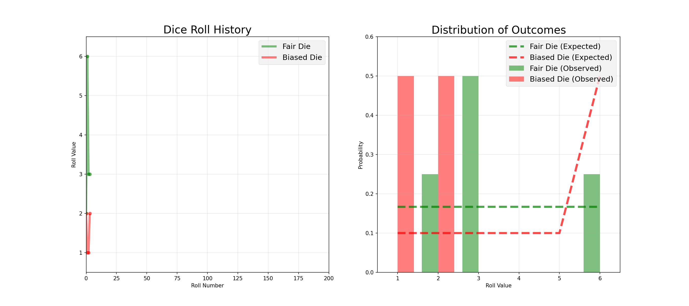
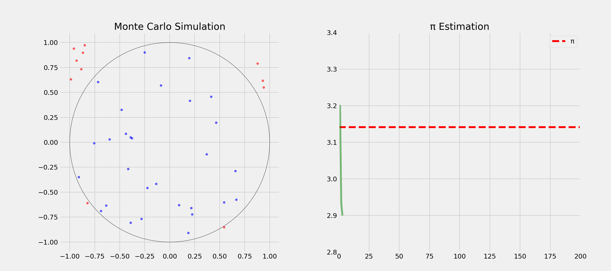
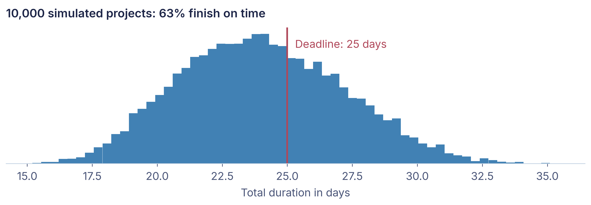
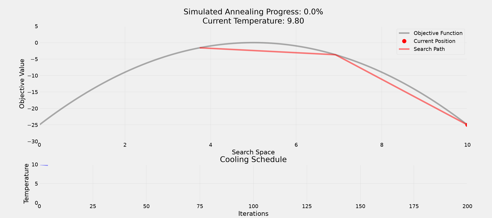
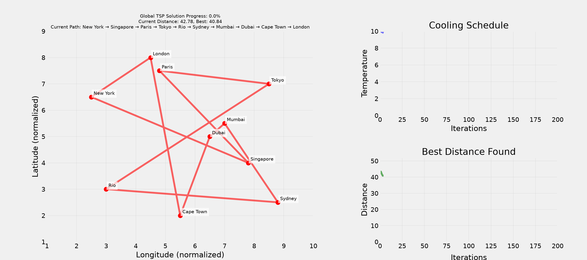

## Today in one sentence

<span class="statement">When a problem is too big to solve exactly, a bit of randomness often gets you a good answer fast.</span>

<span class="eyebrow">Why it matters</span>

Will your project finish on time? Which route through 15 cities is shortest? Questions like these are too complex to calculate exactly. Companies use randomness every day to estimate risks, plan routes and allocate scarce places fairly.

## Roadmap

1.  <span class="roadmap-item future">Randomness everywhere: why chance is useful</span>
2.  <span class="roadmap-item future">Simulate instead of calculate: Monte Carlo</span>
3.  <span class="roadmap-item future">Let chance help you decide: smarter searches, fairer choices</span>

# <span class="flow">Randomness everywhere: why chance is useful</span>

## What comes to your mind?

<span class="question">Question:</span> **What comes to your mind when you think of randomness?**

## <span class="invert-font">Casino</span>

## <span class="invert-font">Lottery</span>

## <span class="invert-font">Shuffling cards</span>

## <span class="invert-font">Algorithms</span>

## <span class="invert-font">Cryptography</span>

## <span class="invert-font">Genetic mutations</span>

## The opposite of randomness is predictability

<span class="question">Question:</span> **What's the opposite of randomness?**

- **Determinism** - same input, same output
- **Predictability** - knowing the outcome in advance
- **Consistency** - reliable patterns

- <span class="highlight">Boredom?</span>

## Is the die fair? Roll it many times

<span class="question">Question:</span> **How would you test if a pair of dice is fair?**

- Send the dice **to a lab** to <span class="highlight">check weight and balance</span>

<!-- -->

- Roll the dice **many times**
- Check if the outcomes are **uniformly distributed**
- Compare **observed** frequencies to **expected** frequencies

## A fair and a loaded die after 200 rolls



## Randomness is a tool, not just a gamble

- **Testing:** random inputs find bugs
- **Optimization:** random steps escape dead ends
- **Simulation:** model systems with uncertainty
- **Security:** stay unpredictable for attackers
- **Fairness:** remove bias from selection

## Where do you meet randomness every day?

<span class="question">Question:</span> **Where do you encounter randomness in daily life?**

## Social life: chance brings people together

- **Dating apps:** Randomized matching within preferences
- **Random encounters** that lead to friendships
- **Career opportunities** from unexpected connections
- **Breaking ties** through coin tosses
- **Netflix recommendations:** Controlled randomness for discovery

## Entertainment: controlled randomness keeps us playing

- **Pokémon:** "Random" encounters weighted by rarity
- **Loot systems:** Rare items have controlled drop rates
- **Chess AI:** Introduces randomness to feel more human-like
- **Spotify shuffle:** Deliberately less random to feel natural
- **TikTok:** Controlled randomization for content discovery

## Security: unpredictability protects us

- **Cryptocurrency mining:** Solving cryptographic puzzles through guessing
- **Password generators:** Balance randomness and memorability
- **`correct-horse-battery-staple`** is more secure than **`Tr0ub4dor&3`**
- **Modern encryption** relies on random number generation
- **Two-factor authentication** uses random codes

## Research: random samples give unbiased answers

- **Weather forecasting:** randomness models uncertainty
- **Stock algorithms:** randomness avoids predictable patterns
- **Self-driving cars:** random elements feel natural
- **Random sampling:** unbiased research results
- **A/B testing:** random assignment to groups

## Why computer scientists love randomness

- **Efficiency:** often faster than deterministic approaches
- **Simplicity:** complex problems, simple code
- **Robustness:** avoids worst-case scenarios
- **Approximation:** "good enough" solutions in reasonable time

## True randomness comes from physics, pseudo-randomness from a seed

<span class="question">Question:</span> **Difference between true and pseudo-randomness?**

<span class="highlight">True Randomness</span>

- Physical phenomena
- Atmospheric noise
- Radioactive decay
- Quantum effects

<span class="highlight">Pseudo-randomness</span>

- Deterministic algorithms
- Seed-based generation
- Repeatable sequences
- Good enough for most uses

## Randomness everywhere: why chance is useful

<span class="eyebrow">What we covered</span>

<span class="statement">Randomness is more than gambling: it makes algorithms faster, systems secure and discoveries possible.</span>

# <span class="flow">Simulate instead of calculate: Monte Carlo</span>

## Roadmap

1.  <span class="roadmap-item done">Randomness everywhere: why chance is useful</span>
2.  <span class="roadmap-item current">Simulate instead of calculate: Monte Carlo</span>
3.  <span class="roadmap-item future">Let chance help you decide: smarter searches, fairer choices</span>

## Some things are too big to count

<span class="question">Question:</span> **How many possible orders exist for a shuffled deck of cards?**

``` python
import math
print(math.factorial(52))
```

    80658175170943878571660636856403766975289505440883277824000000000000

> **Important**
>
> Computing and evaluating all possible combinations is not feasible!

## Monte Carlo: estimate by running many random trials

<span class="question">Question:</span> **Anybody ever heard of "Monte Carlo methods"?**

- 1940s nuclear research: chain reactions were too complex to calculate
- Idea: draw random cases many times and <span class="highlight">count the outcomes</span>
- Named after **Monaco's famous casino**

<span class="question">Question:</span> **How could we estimate π?**

## Estimating π by throwing random points



## Monte Carlo in business: a range instead of a single forecast

- **Project planning:** how likely do we finish before the deadline?
- **Finance:** how much could a portfolio lose in a bad month?
- **Inventory:** how much stock covers an uncertain demand?
- **Recipe:** model the uncertain inputs, draw random values many times

## Most likely 21 days, but only 63 % finish by day 25

Three uncertain tasks, most likely **21 days** in total, deadline **25 days**:



## Simulate instead of calculate: Monte Carlo

<span class="eyebrow">What we covered</span>

<span class="statement">Running many random simulations gives reliable estimates where exact calculation is out of reach.</span>

# <span class="flow">Let chance help you decide: smarter searches, fairer choices</span>

## Roadmap

1.  <span class="roadmap-item done">Randomness everywhere: why chance is useful</span>
2.  <span class="roadmap-item done">Simulate instead of calculate: Monte Carlo</span>
3.  <span class="roadmap-item current">Let chance help you decide: smarter searches, fairer choices</span>

## Ten cities, one trip: which order is shortest?

<span class="question">Question:</span> **In which order would you visit 10 cities by plane with minimal total distance?**

``` python
import math
print(math.factorial(10))
```

    3628800

<span class="question">Question:</span> **What could be a strategy?**

## Brute force: try every route

- Try <span class="highlight">every possibility</span>
- Total possible routes: 10! = **3,628,800**
- **Guaranteed** to find best solution
- If each check takes 1ms: **1 hour** to check all routes

<span class="question">Question:</span> **What could be the problem with this approach?**

## Twenty cities would take 77 million years

- For 20 cities: 20! = **2.4 quintillion** routes
- About **77 million years** at 1 ms per check
- The effort grows <span class="highlight">factorially</span>: not feasible for real problems

## Greedy: always take the shortest next flight

- Make the **locally best** choice at each step
- <span class="highlight">Never backtrack or reconsider</span>
- Fast and simple, but can perform **poorly on complex problems**

## Hill climbing: improve step by step, until you are stuck

- <span class="highlight">Improve the solution</span> by small changes, keep the better one
- Like **climbing in fog**: you only see your immediate surroundings
- You get stuck on a **local optimum**, a small hill, and never see the mountain

<span class="question">Question:</span> **How would you escape a local optimum?**

## Simulated annealing: sometimes accept a worse step

- Make random changes and **accept improvements**
- Sometimes accept **worse solutions**
- Gradually become **more selective**

<span class="question">Question:</span> **Why accept worse solutions sometimes?**

- Randomness helps to escape **local optima**
- Balances <span class="highlight">exploration vs. exploitation</span>

## Annealing on a simple curve



## Annealing finds a short route through ten cities



## Thought experiment: freedom or equality?

**What's more important for a society?**

<span class="highlight">Freedom</span>

- Individual choice
- Personal responsibility
- Market-driven

<span class="highlight">Equality</span>

- Shared resources
- Social safety nets
- Regulated systems

<span class="question">Question:</span> **Any problem with this question?**

## Veil of ignorance: design a society without knowing your place in it

You might <span class="highlight">randomly</span> be:

- Any gender identity and economic status
- Any health condition and intelligence level
- Any cultural background and religious belief

<span class="question">Question:</span> **If you didn't know who you'd be born as, what kind of society would you design?**

## Stories mislead, statistics miss nuance

- **Individual stories:** powerful but potentially misleading
- **Statistics:** comprehensive but can miss nuance
- **Hidden diversity:** important subgroups may be overlooked
- **Small policy changes** <span class="highlight">can have cascading effects</span>

## Which measure of success?

- **Mean happiness:** Average well-being
- **Total happiness:** Utilitarian approach
- **Median happiness:** Focus on the middle class
- **Minimum happiness:** Protecting the most vulnerable

<span class="question">Question:</span> **What could be the problem with these measures?**

## Idea: ask a random sample

- Randomly <span class="highlight">select a subset of the population</span>
- Gather **diverse perspectives** from the sample
- Better understand **needs** of population
- **Reduce selection bias** and improve accuracy

<span class="question">Question:</span> **What is a selection bias?**

## Selection bias: the sample is not the population

**Definition**: The sample you analyze <span class="highlight">is not representative of the population</span> you want to study.

> **Warning**
>
> WWII: engineers wanted to armor returning planes where the bullet holes were. Abraham Wald: armor where there are **no** holes, those planes never returned.

## Random choices can be the fairest choices

<span class="question">Question:</span> **How can randomness promote fairness?**

- **Random allocation** of patients in clinical trials
- **Random audits** for tax compliance
- **Random assignment** of cases to judges
- **Random order** of candidates on voting ballots

## Quick poll: sure 50 or maybe 120?

<span class="question">Question:</span> **Which would you prefer?**

- **100% chance of winning 50 EUR**
- **50% chance of winning 120 EUR**

> **Tip**
>
> Answer depends on your **risk aversion**!

## When to embrace randomness, when to reduce it

<span class="question">Question:</span> **When should we embrace vs. reduce randomness?**

<span class="highlight">Embrace When</span>:

- Exploring new solutions
- Avoiding bias
- Breaking deadlocks
- Testing systems

<span class="highlight">Reduce When</span>:

- Safety-critical systems
- Financial transactions
- Medical procedures
- Legal proceedings

## Good enough beats perfect

- **Perfect is the enemy of good:** approximations work, complete analysis is often impossible
- <span class="highlight">Perfect information is rare</span>
- Quick approximations enable **faster decisions**: balance accuracy against time

## Let chance help you decide: smarter searches, fairer choices

<span class="eyebrow">What we covered</span>

<span class="statement">Random steps help a search escape bad solutions, and random choices can make decisions fairer.</span>

## What we covered

<span class="eyebrow">Randomness everywhere: why chance is useful</span>

Randomness is more than gambling: it makes algorithms faster, systems secure and discoveries possible.

<span class="eyebrow">Simulate instead of calculate: Monte Carlo</span>

Running many random simulations gives reliable estimates where exact calculation is out of reach.

<span class="eyebrow">Let chance help you decide: smarter searches, fairer choices</span>

Random steps help a search escape bad solutions, and random choices can make decisions fairer.

## Why it matters

Will your project finish on time? Which route through 15 cities is shortest? Questions like these are too complex to calculate exactly. Companies use randomness every day to estimate risks, plan routes and allocate scarce places fairly.

## 

When you can't calculate it, simulate it.

## 

Any questions

so far?

## After the break: Randomness

- Tutorial V.I: Programming with AI coding assistants
- Tutorial V.II: Recap of the course topics with randomness
- Monte Carlo simulation of a travel problem in code

# <span class="flow">Literature</span>

## Interesting literature to start

- Christian, B., & Griffiths, T. (2016). Algorithms to live by: the computer science of human decisions. First international edition. New York, Henry Holt and Company.[^1]

## Books on Programming

- Downey, A. B. (2024). Think Python: How to think like a computer scientist (Third edition). O'Reilly. [Free online](https://greenteapress.com/wp/think-python-3rd-edition/)
- Elter, S. (2021). Schrödinger programmiert Python: Das etwas andere Fachbuch (1. Auflage). Rheinwerk Verlag.

> **Note**
>
> Think Python is free online and a great start. Schrödinger programmiert Python is a playful alternative in German.

## More Literature

For more interesting literature, take a look at the [literature list](../general/literature.qmd) of this course.

[^1]: The main inspiration for this lecture. We have read it and discussed it in depth, always wanting to translate it into a course.
