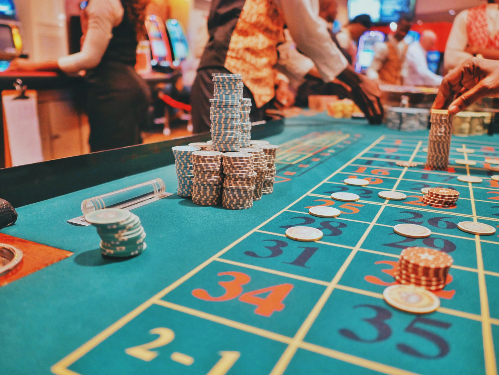
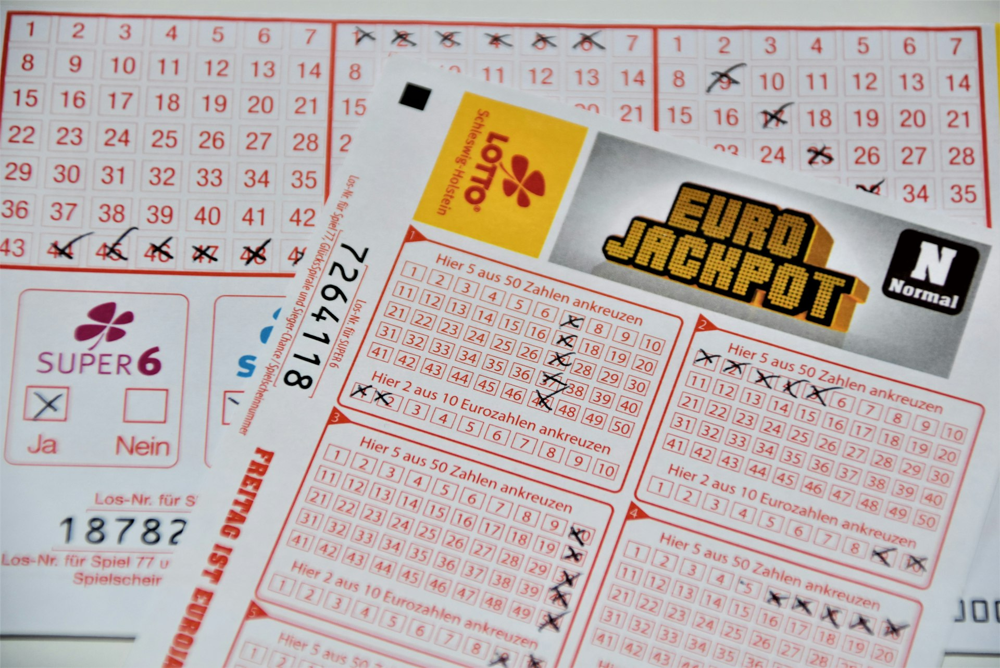
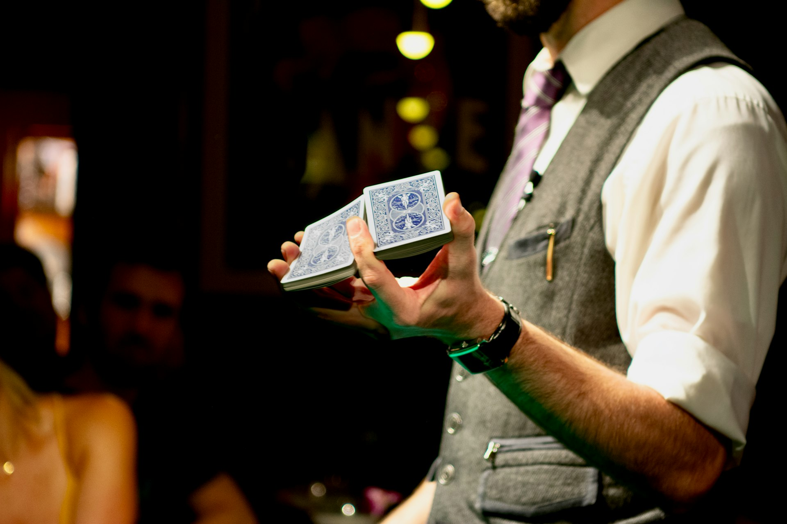
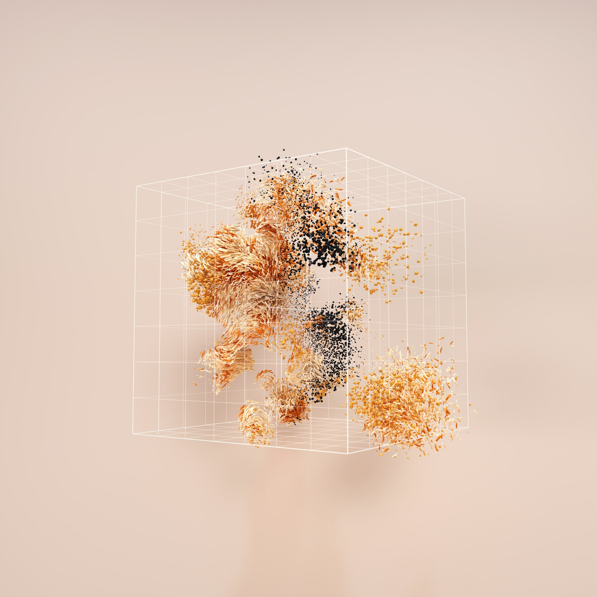
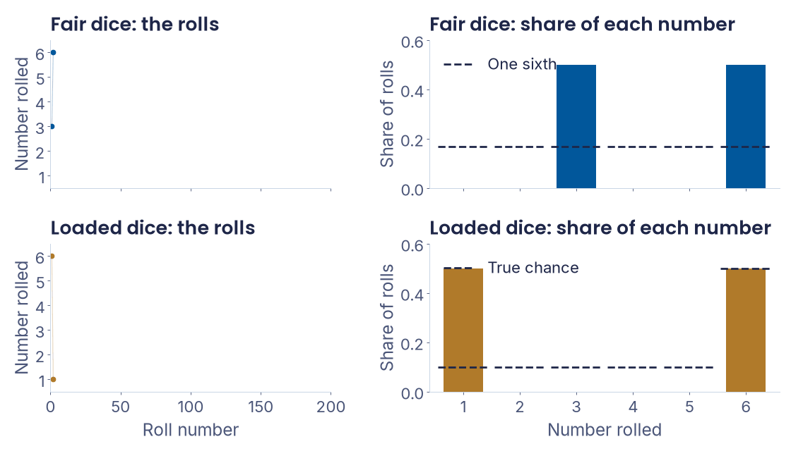
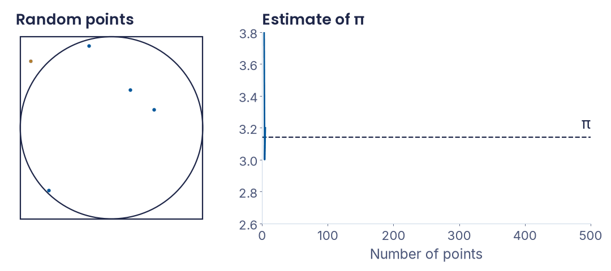
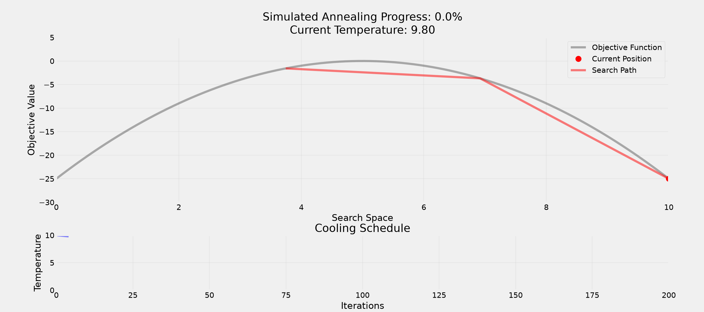
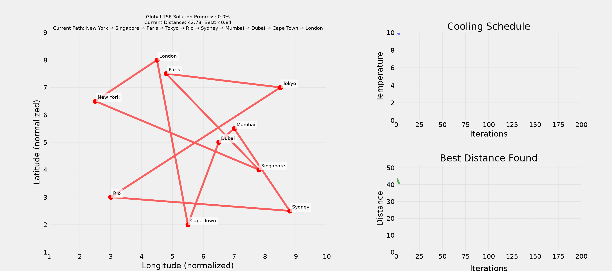

## Today in one sentence {.lecture-opening}

::: {.lecture-summary}
[When a problem is too big to solve exactly, a bit of randomness often gets you a good answer fast.]{.statement}
:::

::: {.lecture-why}
[Why it matters]{.eyebrow}

Will your project finish on time? In which order should a driver visit 20 customers so that the tour is as short as possible? Questions like these are too complex to calculate exactly. Companies use randomness every day to estimate risks, plan delivery tours, survey customers and allocate scarce places fairly.
:::

## Roadmap {.lecture-opening}

::: {.roadmap}
1. [Randomness is a tool]{.roadmap-item .future}
2. [Simulate instead of calculate: Monte Carlo]{.roadmap-item .future}
3. [Search smarter with chance]{.roadmap-item .future}
4. [Sample instead of guess]{.roadmap-item .future}
:::

# [Randomness is a tool]{.flow} {.title visibility="hidden"}

## What comes to your mind?

[Question:]{.question} **What comes to your mind when you think of randomness?**

::: {.notes}
Answer: Open question. Typical answers are casinos, lotteries, dice and shuffled cards. Let us collect a few, then show that randomness is much more than gambling.

Today we see how randomness helps computers and people: it makes systems fair and secure, it lets us estimate what we cannot calculate, and it helps us search for good solutions to problems that are too big to solve exactly.
:::

## Where does randomness show up?

::: {.content-visible when-format="html"}

```{=html}
<div style="display: grid; grid-template-columns: repeat(3, 1fr); gap: 14px 20px;">
<figure style="margin: 0;"><figcaption>Casino</figcaption></figure>
<figure style="margin: 0;"><figcaption>Lottery</figcaption></figure>
<figure style="margin: 0;"><figcaption>Shuffling cards</figcaption></figure>
<figure style="margin: 0;"><figcaption>Algorithms</figcaption></figure>
<figure style="margin: 0;"><figcaption>Cryptography</figcaption></figure>
<figure style="margin: 0;"><figcaption>Genetic mutations</figcaption></figure>
</div>
```

:::

::: {.content-hidden when-format="html"}

::: {layout-ncol=3}


:::

:::

::: {.notes}
Some of these are pure chance (casino, lottery, cards), some use chance on purpose (algorithms, cryptography), and nature has used it all along (genetic mutations).

Photos: Unsplash (photo IDs 1517232115160, 1593453917923, 1691213426024, 1717501220725, 1640161704729, 1465146344425), stored locally.
:::

## What is the opposite of randomness?

[Question:]{.question} **What's the opposite of randomness?**

:::{.incremental}
- **Determinism:** same input, same output
- **Predictability:** knowing the outcome in advance
- **Consistency:** reliable patterns
:::

. . .

- [Boredom?]{.highlight}

::: {.notes}
Answer: Determinism, predictability and consistency. Life without any chance would be reliable, but also a little boring.
:::

## Are these dice fair?

[Question:]{.question} **How would you test if dice are fair?**

:::{.incremental}
- Send them to a lab to check weight and balance
- Or simply: roll them **many times**
- Count how often each number comes up
- Fair dice show each number about **one sixth** of the time
:::

::: {.notes}
Answer: Roll them many times and count. Fair dice show each number about one sixth of the time; loaded dice show one number far more often. We do not need to look inside the dice, we only need enough rolls.
:::

## Fair and loaded dice after 200 rolls


```{python}
#| echo: false
import sys
sys.path.insert(0, "../helpers")
import pathlib
import numpy as np
import matplotlib.pyplot as plt
from matplotlib.animation import FuncAnimation
from course_plots import use_course_style, PRIMARY, AMBER, INK

DIR = pathlib.Path(".").resolve()
np.random.seed(42)  # fixed seed: identical GIFs in animations/ on every run

N_ROLLS = 200
ROLLS_PER_FRAME = 2  # 100 frames at 0.1 s: about 10 seconds
faces = np.arange(1, 7)
fair_p = np.full(6, 1 / 6)
loaded_p = np.array([0.1, 0.1, 0.1, 0.1, 0.1, 0.5])
rows = [
    ("Fair dice", PRIMARY, np.random.choice(faces, N_ROLLS, p=fair_p), fair_p, "One sixth"),
    ("Loaded dice", AMBER, np.random.choice(faces, N_ROLLS, p=loaded_p), loaded_p, "True chance"),
]

with plt.rc_context():
    plt.style.use("default")
    use_course_style()
    plt.rcParams.update({"axes.titlesize": 24, "axes.labelsize": 22,
                         "xtick.labelsize": 20, "ytick.labelsize": 20, "legend.fontsize": 20})
    # same axes in both rows, so fair and loaded can be compared directly
    fig, axes = plt.subplots(2, 2, figsize=(14, 8), dpi=80, sharex="col", sharey="col",
                             width_ratios=[1, 1.25])
    panels = []
    for (name, color, rolls, p, ref), (ax_rolls, ax_share) in zip(rows, axes):
        ax_rolls.set_title(f"{name}: the rolls", fontfamily="Poppins")
        ax_rolls.set_xlim(0, N_ROLLS)
        ax_rolls.set_ylim(0.5, 6.5)
        ax_rolls.set_yticks(faces)
        ax_rolls.set_ylabel("Number rolled")
        trace, = ax_rolls.plot([], [], color=color, linewidth=1, alpha=0.3)
        dots, = ax_rolls.plot([], [], "o", color=color, markersize=6)
        ax_share.set_title(f"{name}: share of each number", fontfamily="Poppins")
        ax_share.set_xlim(0.4, 6.6)
        ax_share.set_ylim(0, 0.6)
        ax_share.set_xticks(faces)
        ax_share.set_ylabel("Share of rolls")
        bars = ax_share.bar(faces, np.zeros(6), width=0.7, color=color)
        ax_share.hlines(p, faces - 0.45, faces + 0.45, colors=INK, linestyles="--",
                        linewidth=2.5, label=ref)
        ax_share.legend(loc="upper left")
        panels.append((rolls, trace, dots, bars))
    axes[1, 0].set_xlabel("Roll number")
    axes[1, 1].set_xlabel("Number rolled")
    fig.tight_layout(h_pad=1.5, w_pad=3)

    def update(frame):
        n = (frame + 1) * ROLLS_PER_FRAME
        x = np.arange(1, n + 1)
        changed = []
        for rolls, trace, dots, bars in panels:
            trace.set_data(x, rolls[:n])
            dots.set_data(x, rolls[:n])
            shares = np.bincount(rolls[:n], minlength=7)[1:] / n
            for bar, share in zip(bars, shares):
                bar.set_height(share)
            changed += [trace, dots, *bars]
        return changed

    anim = FuncAnimation(fig, update, frames=N_ROLLS // ROLLS_PER_FRAME, interval=100, blit=True)
    anim.save(DIR / "../animations/dice_fairness.gif", writer="pillow")
    plt.close(fig)
```



## Where do you meet randomness every day?

[Question:]{.question} **Where do you encounter randomness in daily life?**

:::{.incremental}
- **A/B tests:** visitors are assigned to versions at random
- **Two-factor codes:** random numbers protect your login
- **Surveys:** a random sample gives an unbiased picture
- **Spotify shuffle:** made deliberately *less* random, because true randomness felt wrong to users[^spotify]
- **Tax audits:** random checks keep everyone honest
- **Lotteries:** some universities allocate study places by lottery
:::

[^spotify]: Spotify Engineering (2014). How to shuffle songs? <https://engineering.atspotify.com/2014/02/how-to-shuffle-songs>

::: {.notes}
Answer: Almost everywhere: online shops test versions at random, login codes are random, surveys and tax audits pick people at random, and some universities allocate study places by lottery. Spotify is the surprise: with true shuffle, the same artist sometimes came twice in a row, and users thought the shuffle was broken.
:::

## Randomness is a tool, not just a gamble

:::{.incremental}
- **Fairness:** nobody can influence the outcome
- **Security:** attackers cannot guess what comes next
- **Estimating:** try many random cases instead of calculating every one
- **Searching:** random steps lead out of dead ends
:::

. . .

Estimating and searching are our topics today.

::: {.notes}
We use randomness on purpose, not only in games. Fairness: when nobody can influence the outcome, nobody is favored. Security: passwords, keys and login codes are random, so attackers cannot guess the next one. Estimating: instead of calculating every case, we try many random cases and count. Searching: random steps help a search escape dead ends and find better solutions.
:::

## Can a computer roll dice?

[Question:]{.question} **How can a machine that only calculates produce randomness?**

::: {.columns}
::: {.column .fragment width="50%"}
[True randomness]{.highlight}

- comes from physics
- for example radioactive decay or atmospheric noise
- cannot be repeated
:::

::: {.column .fragment width="50%"}
[Pseudo-randomness]{.highlight}

- comes from a calculation
- looks random, but follows a rule
- can be repeated exactly
:::
:::

. . .

Computers do not roll dice, they calculate. The starting value is called the **seed**. Same seed, same numbers: that is why your tutorial results are reproducible.

::: {.notes}
Answer: It cannot, not really. It calculates numbers that only look random, starting from a seed. For real randomness it needs a physical source, such as noise in its hardware. For simulations, pseudo-randomness is good enough, and the seed makes our results repeatable.
:::

# [Simulate instead of calculate: Monte Carlo]{.flow} {.title visibility="hidden"}

## Roadmap {.section-roadmap}

::: {.roadmap}
1. [Randomness is a tool]{.roadmap-item .done}
2. [Simulate instead of calculate: Monte Carlo]{.roadmap-item .current}
3. [Search smarter with chance]{.roadmap-item .future}
4. [Sample instead of guess]{.roadmap-item .future}
:::

## Some things are too big to count

[Question:]{.question} **How many possible orders exist for a shuffled deck of cards?**

```{python}
#| echo: true
#| eval: true
#| output-location: fragment
import math
print(math.factorial(52))
```

. . .

That is more than the number of atoms on Earth.[^atoms]

. . .

::: {.callout-important}
No computer can ever go through all of these orders one by one.
:::

. . .

[Question:]{.question} **So how do we answer questions about card games?**

[^atoms]: 52! ≈ 8 × 10^67^. Earth has roughly 10^50^ atoms (order of magnitude).

::: {.notes}
Answer: 52 factorial, about 8 times 10 to the 67. Earth has roughly 10 to the 50 atoms, so there are about a hundred million billion times more orders than atoms. Every well shuffled deck is very likely an order that has never existed before.

Answer: By playing many games and counting. That is the story on the next slide.
:::

## A card game in 1946

[Question:]{.question} **Anybody ever heard of Monte Carlo methods?**

:::{.incremental}
- In 1946, the mathematician Stanislaw Ulam was recovering from an illness and played solitaire
- He wondered: what is the chance of winning?
- Calculating it was hopeless. So he thought: just play many games and count the wins
- The idea became the **Monte Carlo method**, named after the casino in Monaco[^ulam]
:::

[^ulam]: Christian & Griffiths (2016), ch. 9.

::: {.notes}
Answer: Monte Carlo methods estimate a result by running many random trials and counting the outcomes. Ulam's question about solitaire is the classic origin story.

Ulam then used the same idea at Los Alamos, together with John von Neumann and Nicholas Metropolis, for nuclear research: chain reactions in nuclear fission were too complex to calculate exactly, so they simulated them with random numbers and counted how often each outcome occurred.
:::

## How could we estimate π?

:::: {.columns}
::: {.column width="45%"}
```{python}
#| echo: false
import sys
sys.path.insert(0, "../helpers")
import numpy as np
import matplotlib.pyplot as plt
from course_plots import use_course_style, PRIMARY, AMBER, INK

with plt.rc_context():
    plt.style.use("default")
    use_course_style()
    rng = np.random.default_rng(42)  # fixed seed: same picture on every run
    pts = rng.uniform(-1, 1, (40, 2))
    inside = (pts ** 2).sum(axis=1) <= 1
    fig, ax = plt.subplots(figsize=(4.5, 4.5))
    ax.add_patch(plt.Rectangle((-1, -1), 2, 2, fill=False, edgecolor=INK, linewidth=2))
    ax.add_patch(plt.Circle((0, 0), 1, fill=False, edgecolor=INK, linewidth=2))
    ax.scatter(*pts[inside].T, s=70, color=PRIMARY, zorder=3)
    ax.scatter(*pts[~inside].T, s=70, color=AMBER, zorder=3)
    ax.set_xlim(-1.05, 1.05)
    ax.set_ylim(-1.05, 1.05)
    ax.set_aspect("equal")
    ax.axis("off")
    fig.tight_layout()
    plt.show()
```
:::

::: {.column width="55%"}
:::{.incremental}
- Throw random points into the square
- Count how many land inside the circle
- The more points we throw, the closer we get to π
:::

::: {.fragment}
The idea goes back to Buffon, who in 1777 dropped needles on lined paper.[^buffon]
:::
:::
::::

[^buffon]: Christian & Griffiths (2016), ch. 9.

::: {.notes}
Answer: By throwing random points. A circle fits exactly inside the square. The circle covers **π/4** of the square, so that is the share of points that land inside it: about 79 %, so about 79 of 100 random points. So: π ≈ 4 × (points inside / all points). Count them, multiply the share by 4, and we have an estimate of π that gets better the more points we throw.

Buffon asked how likely a needle dropped on lined paper crosses a line. The answer contains π, so dropping many needles and counting estimates π. Laplace later pointed out exactly that.
:::

## Let's throw points

```{python}
#| echo: false
import sys
sys.path.insert(0, "../helpers")
import pathlib
import numpy as np
import matplotlib.pyplot as plt
from matplotlib.animation import FuncAnimation
from course_plots import use_course_style, PRIMARY, AMBER, INK

DIR = pathlib.Path(".").resolve()
np.random.seed(42)  # fixed seed: identical GIFs in animations/ on every run

N_POINTS = 500
POINTS_PER_FRAME = 5  # 100 frames at 0.1 s: about 10 seconds
points = np.random.uniform(-1, 1, (N_POINTS, 2))
inside = (points ** 2).sum(axis=1) <= 1
estimates = 4 * np.cumsum(inside) / np.arange(1, N_POINTS + 1)  # estimate after each point

with plt.rc_context():
    plt.style.use("default")
    use_course_style()
    plt.rcParams.update({"axes.titlesize": 24, "axes.labelsize": 22,
                         "xtick.labelsize": 20, "ytick.labelsize": 20})
    # same shape as before (18 x 8), smaller canvas so the text appears larger on the slide
    fig, (ax1, ax2) = plt.subplots(1, 2, figsize=(13.5, 6), dpi=80, width_ratios=[1, 1.6])

    ax1.add_patch(plt.Rectangle((-1, -1), 2, 2, fill=False, edgecolor=INK, linewidth=2))
    ax1.add_patch(plt.Circle((0, 0), 1, fill=False, edgecolor=INK, linewidth=2))
    ax1.set_xlim(-1.05, 1.05)
    ax1.set_ylim(-1.05, 1.05)
    ax1.set_aspect("equal")
    ax1.axis("off")
    ax1.set_title("Random points", fontfamily="Poppins")
    dots_in = ax1.scatter([], [], s=22, color=PRIMARY)
    dots_out = ax1.scatter([], [], s=22, color=AMBER)

    ax2.set_xlim(0, N_POINTS)
    ax2.set_ylim(2.6, 3.8)
    ax2.axhline(np.pi, color=INK, linestyle="--", linewidth=2)
    ax2.text(N_POINTS, np.pi + 0.03, "π", color=INK, fontsize=24, ha="right", va="bottom")
    ax2.set_title("Estimate of π", fontfamily="Poppins")
    ax2.set_xlabel("Number of points")
    estimate_line, = ax2.plot([], [], color=PRIMARY, linewidth=2.5)
    fig.tight_layout(w_pad=3)

    def update(frame):
        n = (frame + 1) * POINTS_PER_FRAME
        dots_in.set_offsets(points[:n][inside[:n]])
        dots_out.set_offsets(points[:n][~inside[:n]])
        estimate_line.set_data(np.arange(1, n + 1), estimates[:n])
        return dots_in, dots_out, estimate_line

    anim = FuncAnimation(fig, update, frames=N_POINTS // POINTS_PER_FRAME, interval=100, blit=True)
    anim.save(DIR / "../animations/pi.gif", writer="pillow")
    plt.close(fig)
```



## Monte Carlo in business: a range instead of a single forecast

:::{.incremental}
- **Project planning:** how likely do we finish before the deadline?
- **Finance:** how much could a portfolio lose in a bad month?
- **Inventory:** how much stock covers an uncertain demand?
:::

. . .

The recipe: describe each uncertain input as a range, draw random values, repeat thousands of times, count.

::: {.notes}
Instead of a single forecast, Monte Carlo gives a range of outcomes with probabilities. The recipe is always the same: describe each uncertain input by a range or distribution, draw random values for all inputs, compute the result, repeat thousands of times, and look at the distribution of results.
:::

## Will we finish in 25 days?

Three uncertain tasks, most likely **21 days** in total, deadline **25 days**:

```{python}
#| echo: false
import sys
sys.path.insert(0, "../helpers")
from course_plots import use_course_style, PRIMARY, RED, INK

rng = np.random.default_rng(42)
runs = 10_000
# (minimum, most likely, maximum) duration in days
tasks = {"Requirements": (3, 5, 10), "Build": (8, 12, 20), "Test": (2, 4, 8)}
total = sum(rng.triangular(low, mode, high, runs) for low, mode, high in tasks.values())
deadline = 25
most_likely = sum(mode for _, mode, _ in tasks.values())  # 21 days
on_time = (total <= deadline).mean()         # share finished by the deadline
within_mode = (total <= most_likely).mean()  # share finished within the most likely 21 days
average = total.mean()                       # mean duration in days
# the numbers written on the slide below come from this simulation
assert (round(on_time * 100), round(within_mode * 100), round(average)) == (63, 18, 24)

with plt.rc_context():
    plt.style.use("default")
    use_course_style()
    fig, ax = plt.subplots(figsize=(7.5, 1.95))  # fits the slide width without scaling
    ax.hist(total, bins=60, color=PRIMARY, alpha=0.75)
    ax.axvline(deadline, color=RED, linewidth=2)
    ax.text(deadline + 0.3, ax.get_ylim()[1] * 0.85, f"Deadline: {deadline} days", color=RED)
    ax.set_xlabel(f"Total duration in days ({runs:,} simulated projects)")
    ax.set_yticks([])
    ax.spines["left"].set_visible(False)
    fig.tight_layout()
    plt.show()
```

:::{.incremental}
- Only **63 %** of the simulated projects finish by day 25
- Only **18 %** finish within the most likely 21 days
- On average, the project takes **24 days**
:::

::: {.notes}
Each task has a minimum, a most likely and a maximum duration: requirements 3, 5 and 10 days, build 8, 12 and 20 days, test 2, 4 and 8 days. Things can go much worse than planned, but rarely much better, so the delays add up. The most likely total of 21 days is the optimistic end of the range, not the middle.
:::

## Monte Carlo in real life

:::{.incremental}
- **You:** plan with a buffer. The most likely duration is too optimistic
- **Companies:** plan projects and budgets as a range with probabilities, not as a single number
:::

. . .

When you can't calculate it, simulate it.

# [Search smarter with chance]{.flow} {.title visibility="hidden"}

## Roadmap {.section-roadmap}

::: {.roadmap}
1. [Randomness is a tool]{.roadmap-item .done}
2. [Simulate instead of calculate: Monte Carlo]{.roadmap-item .done}
3. [Search smarter with chance]{.roadmap-item .current}
4. [Sample instead of guess]{.roadmap-item .future}
:::

## Remember Lecture IV?

:::{.incremental}
- With dependencies, there is often no quick recipe for the best plan
- We said: companies use software that **searches** for a good plan
- Today: how such a search works, and why chance helps
:::

## Ten cities, one trip: which order is shortest?

[Question:]{.question} **In which order would you visit 10 cities by plane with minimal total distance?**

```{python}
#| echo: true
#| eval: true
#| output-location: fragment
import math
print(math.factorial(10))
```

. . .

[Question:]{.question} **What could be a strategy?**

::: {.notes}
Answer: We cannot see it at a glance: there are 3,628,800 possible orders. Strategies students usually suggest: try all orders, always fly to the nearest city next, or start with any tour and improve it step by step. We look at all three now.

This problem has a name: the **travelling salesman problem**. We look for the shortest round trip through all cities. It is not the same as the shortest way between two places, which a navigation app finds in a split second.
:::

## Brute force: try every tour

- Try [every possibility]{.highlight}
- Total possible tours: 10! = **3,628,800**
- **Guaranteed** to find best solution
- If each check takes 1ms: **1 hour** to check all tours

. . .

[Question:]{.question} **What could be the problem with this approach?**

::: {.notes}
Answer: It does not scale. Every additional city multiplies the number of tours, so one hour for ten cities quickly becomes years. The next slide shows how fast.
:::

## What about twenty cities?

:::{.incremental}
- For 20 cities: 20! = **2.4 quintillion** tours
- About **77 million years** at 1 ms per check
- Every additional city multiplies the effort: hopeless for real problems
:::

::: {.notes}
Time complexity grows factorially with the number of cities, and memory requirements increase with the problem size as well. Brute force is not feasible for real-world problems.
:::

## Greedy: always take the nearest city

- From each city, fly to the **nearest city** you have not visited yet
- Never look back or change earlier choices
- Fast and simple

. . .

Problem: the last flights are often very long, because the near cities are already used up.

## Hill climbing: improve step by step

- [Improve the solution]{.highlight} by small changes, keep the better one
- Like **climbing in fog**: you only see your immediate surroundings
- You get stuck on a **local optimum**, a small hill, and never see the mountain

. . .

[Question:]{.question} **How would you escape a local optimum?**

::: {.notes}
Answer: Jump somewhere else and climb again, or sometimes accept a step down. Both ideas use chance, and both come next.

Hill climbing iteratively improves a solution by making small changes. Like climbing in fog, it can only see the immediate surroundings and does not know whether higher peaks exist elsewhere. It can get stuck in local optima and gives no guarantee of finding the global optimum.
:::

## Shake it up: start again somewhere random

:::{.incremental}
- When you are stuck, jump to a **random** new starting point and climb again
- Repeat a few times, keep the best result
- Computer scientists call this **random-restart hill climbing**[^restart]
:::

[^restart]: Christian & Griffiths (2016), ch. 9.

## Simulated annealing

:::{.incremental}
- Make random changes and **accept improvements**
- Sometimes accept a **worse** change
- Over time, accept worse changes less and less
- How often we accept a worse change is called the **temperature**: high at the start, low at the end
:::

. . .

[Question:]{.question} **Why accept a worse change at all?**

. . .

A worse step can lead out of a dead end, towards a higher hill.

. . .

The name comes from metalworking: heat the metal, then let it cool slowly.[^kirkpatrick]

[^kirkpatrick]: Kirkpatrick, S., Gelatt, C. D. & Vecchi, M. P. (1983). Optimization by simulated annealing. Science, 220(4598).

::: {.notes}
Answer: Because a worse step can lead out of a dead end. Without it, we stay on the first small hill we find; with it, we can cross a valley and reach a higher one.

The name comes from metalworking: annealing means heating metal and cooling it slowly, so the atoms settle into a strong structure. Scott Kirkpatrick and colleagues at IBM used this idea for optimization in 1983. The "temperature" says how often a worse change is accepted, and it drops over time.
:::

## Annealing on a simple curve

```{python}
#| echo: false
plt.style.use('fivethirtyeight')  # style of both annealing GIFs, keeps them unchanged
np.random.seed(42)  # fixed seed: identical GIFs in animations/ on every run
# Setup the figure with two subplots: main visualization and temperature
fig, (ax1, ax2) = plt.subplots(2, 1, figsize=(18, 8), height_ratios=[3, 1], dpi=150)
plt.subplots_adjust(hspace=0.3)

# Generate the objective function (parabola)
x = np.linspace(0, 10, 200)
y = -((x-5)**2)  # Parabola with maximum at x=5
ax1.plot(x, y, 'k-', alpha=0.3, label='Objective Function')

# Initialize starting position (random x between 0 and 10)
current_x = np.random.uniform(0, 10)
current_y = -((current_x-5)**2)
point, = ax1.plot([current_x], [current_y], 'ro', markersize=10,
                  label='Current Position')

# Animation parameters
initial_temp = 10.0
temperature = initial_temp
cooling_rate = 0.995
path_x = [current_x]
path_y = [current_y]
temperatures = [temperature]

# Plot search path
line, = ax1.plot(path_x, path_y, 'r-', alpha=0.5, label='Search Path')

# Temperature plot
temp_line, = ax2.plot(temperatures, 'b-', alpha=0.5, label='Temperature')

def update(frame):
    global current_x, current_y, temperature

    # Propose new solution (larger steps when temperature is high)
    new_x = current_x + np.random.normal(0, temperature)
    new_x = np.clip(new_x, 0, 10)  # Keep within bounds
    new_y = -((new_x-5)**2)

    # Acceptance probability (higher temp = more likely to accept worse solutions)
    if new_y > current_y:  # Always accept better solutions
        acceptance = True
    else:
        prob = np.exp((new_y - current_y) / temperature)
        acceptance = np.random.random() < prob

    # Update position if accepted
    if acceptance:
        current_x = new_x
        current_y = new_y

    # Cool down system
    temperature *= cooling_rate

    # Update visualization
    path_x.append(current_x)
    path_y.append(current_y)
    temperatures.append(temperature)

    line.set_data(path_x, path_y)
    point.set_data([current_x], [current_y])
    temp_line.set_data(range(len(temperatures)), temperatures)

    # Update progress text
    progress = frame / 200 * 100
    ax1.set_title(f'Simulated Annealing Progress: {progress:.1f}%\n'
                  f'Current Temperature: {temperature:.2f}')

    return line, point, temp_line

# Setup axis limits and labels
ax1.set_xlim(0, 10)
ax1.set_ylim(-30, 5)
ax1.grid(True, alpha=0.3)
ax1.set_xlabel('Search Space')
ax1.set_ylabel('Objective Value')
ax1.legend(loc='upper right')

ax2.set_xlim(0, 200)
ax2.set_ylim(0, initial_temp)
ax2.grid(True, alpha=0.3)
ax2.set_xlabel('Iterations')
ax2.set_ylabel('Temperature')
ax2.set_title('Cooling Schedule')

# Create and save animation
anim = FuncAnimation(fig, update, frames=200, interval=50, blit=True)
anim.save(DIR / '../animations/simulated_annealing.gif', writer='pillow')
plt.close()
```



## Annealing finds a short tour through ten cities

```{python}
#| echo: false
import numpy as np
np.random.seed(42)  # fixed seed: identical GIFs in animations/ on every run
import matplotlib.pyplot as plt
from matplotlib.animation import FuncAnimation
import pathlib

DIR = pathlib.Path(".").resolve()

# Setup
fig = plt.figure(figsize=(18, 8), dpi=150)
# Create a grid layout with 1x2 main grid, and stack 2 plots on the right
gs = fig.add_gridspec(1, 2, width_ratios=[3, 2])
gs_right = gs[1].subgridspec(2, 1, height_ratios=[1, 1])

# Create axes with the new layout
ax1 = fig.add_subplot(gs[0])  # Main plot on left
ax2 = fig.add_subplot(gs_right[0])  # Top right
ax3 = fig.add_subplot(gs_right[1])  # Bottom right

plt.style.use('fivethirtyeight')
plt.subplots_adjust(wspace=0.2)  # Adjust spacing between plots

# Define major international cities with their coordinates
# Using approximate normalized coordinates for visualization
cities_data = {
    'Tokyo': (8.5, 7.0),
    'New York': (2.5, 6.5),
    'London': (4.5, 8.0),
    'Paris': (4.8, 7.5),
    'Dubai': (6.5, 5.0),
    'Singapore': (7.8, 4.0),
    'Sydney': (8.8, 2.5),
    'Rio': (3.0, 3.0),
    'Cape Town': (5.5, 2.0),
    'Mumbai': (7.0, 5.5)
}

city_names = list(cities_data.keys())
cities = np.array(list(cities_data.values()))
n_cities = len(cities)

# Initial route: simple sequential route
current_route = np.arange(n_cities)
np.random.shuffle(current_route)

# Calculate route distance
def calculate_distance(route):
    total = 0
    for i in range(len(route)):
        city1 = cities[route[i]]
        city2 = cities[route[(i + 1) % len(route)]]
        total += np.sqrt(np.sum((city1 - city2) ** 2))
    return total

# Animation parameters
initial_temp = 10.0
temperature = initial_temp
cooling_rate = 0.995
distances = [calculate_distance(current_route)]
best_distances = [distances[0]]
best_distance = distances[0]
best_route = current_route.copy()

# Plot cities, route, and names
scatter = ax1.scatter(cities[:, 0], cities[:, 1], c='red', s=100)
line, = ax1.plot([], [], 'r-', alpha=0.6)
temp_line, = ax2.plot([], [], 'b-', alpha=0.6)
obj_line, = ax3.plot([], [], 'g-', alpha=0.6)

# Add city names as annotations with better positioning
for i, (x, y) in enumerate(cities):
    ax1.annotate(city_names[i], (x, y), xytext=(5, 5),
                textcoords='offset points', fontsize=10,
                bbox=dict(facecolor='white', edgecolor='none', alpha=0.7))

def update_route_visualization():
    route_coords = np.concatenate([cities[current_route], [cities[current_route[0]]]])
    line.set_data(route_coords[:, 0], route_coords[:, 1])

def update(frame):
    global current_route, temperature, best_distance, best_route

    # Propose new solution by swapping two random cities
    new_route = current_route.copy()
    idx1, idx2 = np.random.choice(len(new_route), 2, replace=False)
    new_route[idx1], new_route[idx2] = new_route[idx2], new_route[idx1]

    # Calculate distances
    current_distance = calculate_distance(current_route)
    new_distance = calculate_distance(new_route)

    # Acceptance probability
    if new_distance < current_distance:
        acceptance = True
    else:
        prob = np.exp((current_distance - new_distance) / temperature)
        acceptance = np.random.random() < prob

    # Update if accepted
    if acceptance:
        current_route = new_route
        if new_distance < best_distance:
            best_distance = new_distance
            best_route = new_route.copy()

    # Cool down system
    temperature *= cooling_rate

    # Update visualization
    update_route_visualization()
    distances.append(calculate_distance(current_route))
    best_distances.append(best_distance)

    temp_line.set_data(range(len(distances)),
                      [initial_temp * (cooling_rate ** i) for i in range(len(distances))])
    obj_line.set_data(range(len(best_distances)), best_distances)

    # Update progress text with arrow symbol
    progress = frame / 200 * 100
    current_path = ' → '.join([city_names[i] for i in current_route])
    ax1.set_title(f'Global TSP Solution Progress: {progress:.1f}%\n'
                  f'Current Distance: {distances[-1]:.2f}, Best: {best_distance:.2f}\n'
                  f'Current Path: {current_path}', fontsize=10)

    return line, temp_line, obj_line

# Adjust axis limits and labels
ax1.set_xlim(1, 10)
ax1.set_ylim(1, 9)
ax1.grid(True, alpha=0.3)
ax1.set_xlabel('Longitude (normalized)')
ax1.set_ylabel('Latitude (normalized)')

# Make the right-side plots slightly more compact
ax2.set_xlim(0, 200)
ax2.set_ylim(0, initial_temp)
ax2.grid(True, alpha=0.3)
ax2.set_xlabel('Iterations')
ax2.set_ylabel('Temperature')
ax2.set_title('Cooling Schedule')


plt.subplots_adjust(wspace=0.3, hspace=0.5)

# Bottom subplot margins
ax3.set_xlim(0, 200)
ax3.set_ylim(0, calculate_distance(current_route) * 1.2)
ax3.grid(True, alpha=0.3)
ax3.set_xlabel('Iterations', labelpad=10)
ax3.set_ylabel('Distance')
ax3.set_title('Best Distance Found')

# Initial route visualization
update_route_visualization()

# Create and save animation
anim = FuncAnimation(fig, update, frames=200, interval=50, blit=True)
anim.save(DIR / '../animations/tsp_annealing.gif', writer='pillow')
plt.close()
```



## Explore early, exploit late, again

:::{.incremental}
- Annealing starts with a lot of randomness and gets more careful over time
- That is exactly the idea from **Lecture II**: explore while you have time, exploit when the end is near
- The book's advice for life: try a lot early, then settle down[^explore]
:::

[^explore]: Christian & Griffiths (2016), ch. 2 and ch. 9.

## Random search in real life

:::{.incremental}
- **You:** stuck on a problem? Change something at random: another place, another order, another person to ask
- **Companies:** delivery tours and production plans that nobody can calculate exactly are found by software that searches with chance
:::

. . .

Randomness is not giving up. Often it is the only way through.

# [Sample instead of guess]{.flow} {.title visibility="hidden"}

## Roadmap {.section-roadmap}

::: {.roadmap}
1. [Randomness is a tool]{.roadmap-item .done}
2. [Simulate instead of calculate: Monte Carlo]{.roadmap-item .done}
3. [Search smarter with chance]{.roadmap-item .done}
4. [Sample instead of guess]{.roadmap-item .current}
:::

## Thought experiment: freedom or equality?

So far, chance helped us with numbers and tours. Now a bigger question:

[Question:]{.question} **What's more important for a society?**

::: {.columns}
::: {.column .fragment width="50%"}
[Freedom]{.highlight}

- Individual choice
- Personal responsibility
- Market-driven
:::

::: {.column .fragment width="50%"}
[Equality]{.highlight}

- Shared resources
- Social safety nets
- Regulated systems
:::
:::

. . .

[Question:]{.question} **Any problem with this question?**

::: {.notes}
Answer: Yes: our answer depends on where we stand. Someone rich and healthy may prefer freedom, someone poor or ill may prefer equality. To judge fairly, we would have to forget our own place in society. That is the idea on the next slide.
:::

## The veil of ignorance

The philosopher John Rawls proposed a thought experiment: design a society **before you know who you will be in it**.[^rawls]

You might [randomly]{.highlight} be:

- Any gender identity and economic status
- Any health condition and intelligence level
- Any cultural background and religious belief

. . .

[Question:]{.question} **If you didn't know who you'd be born as, what kind of society would you design?**

[^rawls]: Rawls, J. (1971). A Theory of Justice. See Christian & Griffiths (2016), ch. 9.

::: {.notes}
Answer: Open question. Many students design a society with a safety net, because they could end up at the bottom. The philosopher John Rawls called this the veil of ignorance: we decide as if our place in society were assigned at random.
:::

## How do we judge a whole society?

[Question:]{.question} **How can we know what a policy does to millions of people?**

:::{.incremental}
- To answer Rawls, we would have to imagine millions of different lives
- Nobody can calculate that
- **Individual stories** are powerful, but can mislead
- **Statistics** cover everyone, but hide the single life
:::

::: {.notes}
Answer: Not from single stories, and not from one average either. We need many cases, and a fair way to pick them. That is where chance comes in.

But that's not all: we also need to decide how to measure success and failure of a policy.
:::

## Which measure of success?

- **Mean happiness:** the average
- **Total happiness:** the sum over all people
- **Median happiness:** the person in the middle
- **Minimum happiness:** the person who is worst off

. . .

[Question:]{.question} **What could be the problem with these measures?**

::: {.notes}
Answer: Each measure hides something. The mean can rise while many people are worse off, the total rewards simply having more people, the median ignores both ends, and the minimum ignores everyone except the worst-off. There is no neutral choice: picking the measure is already a value judgment.
:::

## Ask a random sample

:::{.incremental}
- This is Monte Carlo again: we cannot ask everyone, so we ask a random few
- A random few show the whole range of lives, not only the loudest or the luckiest
- The charity GiveDirectly publishes **randomly chosen** reports from the people it supports, not only the success stories[^givedirectly]
:::

[^givedirectly]: Christian & Griffiths (2016), ch. 9.

## Who is missing from your sample?

[Question:]{.question} **What is a selection bias?**

. . .

**Definition**: The sample you analyze [is not representative of the population]{.highlight} you want to study.

. . .

::: {.callout-warning}
WWII: engineers wanted to armor returning planes where the bullet holes were. Abraham Wald: armor where there are **no** holes, those planes never returned.
:::

. . .

Learning only from successful companies is the same mistake.

::: {.notes}
Answer: The people or cases we look at are not a fair picture of all of them, because the way we picked them leaves some out.

The famous example of survivorship bias: engineers studied returning planes to decide where to add armor and initially focused on the areas with the most bullet holes. Abraham Wald pointed out that they should armor the areas without bullet holes, because planes hit there did not survive to return. The same happens when we study only successful companies: the failed ones with the same strategy are missing.
:::

## Sampling in real life

:::{.incremental}
- **You:** before a big decision, ask a few people at random, not only those who shout the loudest
- **Companies:** random customer surveys and random quality checks show the real picture
:::

. . .

A random few can tell us about the many.

## Can chance be fair?

[Question:]{.question} **How can randomness promote fairness?**

:::{.incremental}
- **Random allocation** of patients in clinical trials
- **Random audits** for tax compliance
- **Random assignment** of cases to judges
- **Random order** of candidates on voting ballots
:::

::: {.notes}
Answer: When nobody can influence the outcome, nobody is favored. A coin does not care who you are, so random choices remove bias wherever people would otherwise pick.
:::

## When should we use chance?

::: {.columns}
::: {.column width="50%"}
[Use chance to]{.highlight}

- explore new solutions
- estimate what we cannot calculate
- choose fairly
:::

::: {.column .fragment width="50%"}
[Avoid chance when]{.highlight}

- the same input must always give the same result
- for example a bank transfer, the dose of a medicine or the brakes of a car
:::
:::

. . .

Good enough now often beats perfect too late.

::: {.notes}
Answer: Use chance to explore new solutions, to estimate what we cannot calculate and to choose fairly. Avoid it where the same input must always give the same result, for example a bank transfer, the dose of a medicine or the brakes of a car.

Remember the Monte Carlo methods: approximations work. Many real-world problems benefit from embracing uncertainty rather than fighting it. Quick approximations enable faster decisions, balance accuracy against computation time, random sampling against complete enumeration.
:::

## What we covered {.lecture-closing}

::: {.covered-list}
::: {.covered-item}
[Randomness is a tool]{.eyebrow}

Chance makes systems fair, secure and unpredictable.
:::

::: {.covered-item}
[Simulate instead of calculate: Monte Carlo]{.eyebrow}

Many random trials give an honest range instead of a single guess.
:::

::: {.covered-item}
[Search smarter with chance]{.eyebrow}

Random steps lead out of dead ends.
:::

::: {.covered-item}
[Sample instead of guess]{.eyebrow}

A random few can tell us about the many.
:::

:::

## Why it matters {.lecture-closing}

::: {.lecture-why .closing}
Will your project finish on time? In which order should a driver visit 20 customers so that the tour is as short as possible? Questions like these are too complex to calculate exactly. Companies use randomness every day to estimate risks, plan delivery tours, survey customers and allocate scarce places fairly.
:::

## {.loud-slide .lecture-key}

::: {.r-fit-text}
When you can't calculate it, simulate it.
:::

## {.loud-slide}
::: {.r-fit-text}
Any questions

so far?
:::

## After the break: AI and a recap

- Tutorial V.I: How AI writes code
- Tutorial V.II: Recap of the course with randomness

::: {.notes}
That's it for today's lecture! After the break we look at how AI tools write code, and why there is a bit of randomness in that too. Then we recap the course, each topic with a bit of randomness.
:::




